# Data model

The tables of Rentalars, what they mean and how they hang together. The
names are those of the Python classes; the table in the database is
`<package>_<class in lower case>`, e.g. `material_materialitem`.

German terms of the catalogue have fixed English names (catalogue section
2.1). The ones you need to read this page:

| German | English in the code |
|---|---|
| Materialmodell / Exemplar | `MaterialModel` / `MaterialItem` |
| Produkt / Set / Bestandteil | `Product` / kit / `KitComponent` |
| Projekt / Teilgruppe / Materialposition | `Project` / `Group` / `MaterialLine` |
| Staffel | `RentalScale` |
| Zumietung | subrental |
| Packliste | `Packlist` |
| Veranstaltungsort | `Venue` |
| Zeitplanung / Phase / offener Punkt | course / `ProjectPhase` / `OpenItem` |
| Projektkürzel | project tag |
| Prüfart / Prüfung | `InspectionType` / `Inspection` |
| Sperrzeit | `ItemBlock` (blocked period) |
| Herauslösen (für ein Projekt) | `Extraction` |
| Nachtrag (beim Packen ergänzt) | addendum (`MaterialLine.is_addendum`) |
| Angebot / Auftragsbestätigung / Lieferschein / Rechnung / Storno / Crew-Disposition | `Document` of kind `offer` / `order_confirmation` / `delivery_note` / `invoice` / `cancellation` / `crew_sheet` |
| Qualifikation, Nachweis | `Qualification` |
| Verfügbarkeitskalender (grün, gelb, rot) | `AvailabilityMark` |
| Verfügbarkeitsserie | `AvailabilitySeries` |
| verknüpfter Kalender | `CalendarFeed` |
| Funktion und Sätze (Stundensatz, Tagessatz) | `PersonJobFunction` (`hourly_rate`, `daily_rate`) |
| Postfach / Anfrage (Mail ohne Kennung) | `Mailbox` / inquiry (`UnknownTagMail` without tag) |
| Gewinn aus dem Projekt | profit of the project (`contribution_margin`) |
| Projektvorlage | `ProjectTemplate` |
| Zugriffsprotokoll / Mail-Protokoll | `AccessLogEntry` / `MailLogEntry` |
| Gesamtprojekt / Teilprojekt | whole project / subproject (`Project.parent`) |
| Übernahme (aus einem anderen Teilprojekt) / Übergabe | take-over (`MaterialLine.taken_over_from`) / handover (`Handover`) |
| Untergruppe, übergeordnete Teilgruppe | subgroup, parent group (`Group.parent`) |
| Webhook / Zustellung | `Webhook` / `WebhookDelivery` |
| Buchhaltung, Beleg, Buchungsstapel | accounting (`AccountingSettings`), voucher (`LexwareTransfer`), DATEV export |
| Kundenmaterial, Fremdmaterial (Kategorie C), Eigentümer | customer material (`Category.is_customer_material`), owner (`Product.owner`) |
| frühere Projektnummer (die mit „P-“) | former number (`Project.former_number`) |
| Packen/Ausgabe: gepackt, ausgegeben / Rücknahme: zurück abgehakt, zurückgenommen | `PackEntry.packed_quantity`, `issued_quantity` / `returned_quantity` (ticked), `taken_back_quantity` (booked) |
| angefragter Zeitraum (einer Personalposition) | `CrewLine.requested_start` / `requested_end` |
| Einsatzanfrage per Mail, Antwort per Mail | deployment request by mail (`CrewRequestMail`), crew answer (`MailSettings.crew_answers`) |
| Packen / Nachbereitung / Planungen und Besprechungen | phase kinds `loading` / `aftercare` / `planning` (`PhaseKind`) |
| Dienstleistungsprodukt (genau eines je Funktion) | service product (`JobFunction.service_product`, one-to-one) |
| Nebenkosten | product kind `incidental` (`ProductKind.INCIDENTAL`) |
| Grenze in Stunden pro Tag, Preis / Stundensatz ab der Grenze | hour tiers: `hours_limit`, `price_above_limit` (product), `unit_price_above_limit`, `hourly_rate_above_limit` (crew line, rate) |
| Überblick | deployment view (`projects:deployment`) |
| Zumietung bei … (Seite je Projekt und Lieferant), Dokument des Lieferanten | subrental page, supplier document (`ProjectFile.supplier`, `supplier_document_kind`) |
| Wiedervorlage | follow-up (`Project.follow_up_on`, `follow_up_note`, `follow_up_user`) |
| Beschreibung, Rechnungsdatum, Start-ID | `MaterialModel.specification`, `MaterialItem.purchase_date`, start number of new items |
| Standard-Lagerort („Hauptlager“) | `StorageLocation.is_default` |
| Servicefall (offen, in Arbeit, erledigt), Gemeldet von, Zuständig | service case: `Project.kind` `service_case`, `Project.case_status`, `case_contact`, `manager` |
| In Teilprojekte gliedern | dividing a project (`projects/split.py`; no field of its own) |
| Showfile, Pult oder Software, aktuelle Show | show file: `DocumentType.is_showfile`, `ProjectFile.show_system`, `show_version`, `is_current_show` |
| Chat, Erwähnung, gelesen bis | `ChatMessage` (`mentioned`), `ChatReadMark` |
| Automation („Wenn … dann …“), Ausführung | `Automation` (trigger, action), `AutomationRun` |
| Position einer Adresse, Anschrift des Lagers | `AddressPosition`, `CompanyProfile.warehouse_address` |
| Fahrten, „wird beim Lieferanten abgeholt“ | trips (`projects/trips.py`, not stored), `MaterialLine.picked_up_at_supplier` |
| Rechnung gestellt / keine Rechnung / früher abgeschlossen | `Project.invoice_status` `issued` / `not_needed` / `earlier` (`InvoiceMark`) |
| Erinnerung an die Rechnung | `InvoiceNotice` (notifications), settings in `NotificationSettings.invoice_*` |
| Kaufset, Preis enthalten in | purchase set, `MaterialItem.purchase_price_in` |
| Etiketten-Einstellungen | `LabelSettings` (material) |
| Notiz in der Korrespondenz | `ProjectMail` with `direction` `note` |
| Servicefall aus einer Defektmeldung, interner Servicefall | `Project.source_defect`, `Project.is_internal` on a service case |
| Defektmeldung unter Anfragen | `UnknownTagMail.defect_report` |
| Zuschläge (Nacht, Sonntag, Feiertag) – nicht Aufpreis | time surcharges: `TimeSurchargeSettings`, `CrewLine.time_surcharges_on_price`/`…_on_cost`, `Product.time_surcharges` (the product kind „Aufpreis“ stays `surcharge`) |
| Spesen, Kilometersatz, Beleg, erstattet | `Expense` (`km_rate`, `receipt`, `reimbursed_on`), `SystemSettings.expense_km_rate` |
| Hinweise bei auffälligen Zeiten | time hints (`timetracking/hints.py`, not stored), limits `SystemSettings.time_hint_*`, switch `time_hints_enabled` |
| Weitere Adressen (Aliasse) eines Postfachs, „nur für Servicefälle“, Empfangsadresse | `MailboxAddress` (`untagged`, `for_service_cases`, `case_manager`), `UnknownTagMail.address` |
| Beteiligte eines Servicefalls | `ServiceCaseParticipant` |
| Zeitraum mit mehreren Funktionen, Teil | divided period: `TimeEntry` rows sharing `period_key`, one per part |
| Zuschlagsregel, eigener Feiertag | `TimeSurchargeRule`, `OwnHoliday` (`TimeSurchargeSettings` keeps state and switches) |
| Entfernung Wohnung – Betrieb, abgezogener Arbeitsweg | `Person.commute_km`, `Expense.commute_km`, switch `SystemSettings.expense_deduct_commute` |
| Uhrzeit der Wiedervorlage | `Project.follow_up_at` |
| „In der App“, Kategorie einer Benachrichtigung | `Preference.companion`, `Notification.companion`; category in `notifications/categories.py` (not stored) |
| Fahrt anpassen, entfernen, eigene Fahrt, Notiz für die Fahrer | `TripAdjustment` (`trip_key`, `is_removed`, `note`); the computed trips stay in `projects/trips.py` |
| „übernehmen ab“, „nur ungelesene Mails“ | `Mailbox`/`MailboxAddress` `untagged_since`, `untagged_unread_only` |
| Änderungszähler einer Packlistenzeile, Abgleichsbeleg | `PackEntry.version`, `SyncReceipt` |
| Sperre bei If-Match | `api.WriteLock` |
| Meine Einsätze (Reiter) | crew lines of the user's person (`projects/my_deployments.py`, not stored) |
| Sprache eines Kontos, Sprache der Dokumente | `User.language` (`""` = the installation's), `CompanyProfile.document_language` |
| Serveradresse und Zertifikat, vorbereitete Änderung | `AddressChange` (`core/address_models.py`) |
| wartet (auf Rückmeldung, Aktion, Materiallieferung), wartet auf Schließen, Rückstand | `Project.case_status` `waiting` / `closing` / `backlog`, `Project.case_waiting_for` `reply` / `action` / `delivery` |
| KI: Einstellungen, Schnittstelle, Zusammenfassung, Protokoll der KI-Aufrufe | `ai.AISettings`, `AIProvider`, `AISummary`, `AICall` |
| Kurzüberblick ohne KI | `ai/overview.py` (not stored) |
| neue Kommunikation im Servicefall, Status des Servicefalls setzen | triggers `case_follow_up` / `case_communication`, action `case_status`; `Automation.communication`, `Automation.new_case_status` |
| Änderungszeit je Feld eines Projekts/Servicefalls | `Project.field_changed_at` (JSON, API key → UTC moment; `projects/field_changes.py`) |
| Änderungszeit von Telefon, E-Mail, Freigaben einer Person | `Person.phone_changed_at`, `email_changed_at`, `share_phone_changed_at`, `share_email_changed_at` |
| Benachrichtigungen der Firma: Fehlbestände – Uhrzeit, Rhythmus, Vorlauf | `NotificationSettings` (`core/notification_settings.py`; schedule in `notifications/schedule.py`) |
| Grund einer abgelehnten Änderung aus der App | `SyncReceipt.reason` (`needs_project_write`, `above_packing_list`, …) |
| Material nachtragen beim Packen dürfen | `packing.services.may_add_material` (not stored; write on packing everywhere or edit access to the project) |
| gemessene Lese- und Schreibgeschwindigkeit der KI | `AISettings`/`AICall` speed fields (`ai/speed.py`); processor from `ai/cpu.py` (not stored) |
| fest eingeplant (ohne Anfrage) | `CrewLine.request_status` `firm` (`RequestStatus.FIRM`) |
| Kauf einpflegen, Rechnung lesen | purchase entry (`material/purchases.py`; no table of its own – the items and one shared `MaterialFile` of kind `invoice`), `AISettings.invoice_source`/`invoice_provider` |
| Nur zugeordnete Projekte, Überblick ohne Planung | `Role.project_scope` `deployment` (`ProjectScope.DEPLOYMENT`) |
| Verfügbarkeit von Material sehen | special right `availability` (`SpecialRight.AVAILABILITY`) |
| Zeiten zur Freigabe (Erinnerung) | `NotificationSettings.approval_*`, `ApprovalNotice` (notifications) |
| Ausgangsbelege | outgoing documents: `Document` rows of the customer kinds (`documents/outgoing.py`; no table of its own) |
| Finanzen, Personaldaten, Kundendaten (Spalten) | data access (`accounts/data_access.py`, computed from the roles, not stored) |
| Audit, To-Do, Audit-Intervall, Schnellauswahl | `ItemAudit`, `ItemTodo`, `AuditSettings.interval_months`, `quick_todos` (material, `audit_models.py`) |
| Offene Punkte der Materialverwaltung, Audit-Modus | open points (`material/audit_views.py`, `audit_tables.py`; not stored), audit mode (`material:audit`; the round lives in the session) |
| Eigenes Feld, Feldsatz, vertraulich | `CustomField` (`is_sensitive`), `Fieldset` with `FieldsetEntry`, `ModelFieldset`, `CustomFieldValue` (app `customfields`) |
| Foto oder Video im Chat | `ChatAttachment` (chat) |
| Nachricht mit Schloss / offen | `ProjectMail.locked`; defaults `MailSettings.lock_new_in_projects`, `lock_new_in_cases` |
| Verwandte Projekte und Servicefälle | `ProjectRelation` (projects) |
| Personalplätze einer Phase, „Personal für diese Phase“ | open crew lines (`CrewLine` without person) made by `projects/staffing.py`; not stored as such |
| Wer Zugriff hat | access rows (`projects/access_rows.py`, computed) |
| Einträge je Seite (gemerkt je Nutzer und Liste) | `TablePreference.page_size` |
| Export im Importformat | `core/import_exports.py` and `<app>/import_export.py` (not stored) |
| Schutzklasse, eigene Schutzklasse | protection class: `MaterialModel.protection_class`, `MaterialItem.protection_class_override`, `effective_protection_class` (`ProtectionClass`) |
| elektrische Prüfung (DGUV V3), Messwerte, Grenzwert, Prüfgerät, Sichtprüfung, Funktionsprüfung „entfällt“ | electrical inspection: `InspectionType.is_electrical`; measured values on `Inspection` (`pe_resistance_ohm` …, `test_device`, `visual_check_passed`, `function_test_passed` null); limits and verdicts in `material/dguv.py` (not stored) |
| Prüfprotokoll (PDF der elektrischen Prüfung) – nicht das hochgeladene „Protokoll“ | test report (`material/inspection_report.py`, not stored); the uploaded file stays `Inspection.protocol` |
| Kalender-Link | `CalendarLink` (schedule) |
| Standard-Automation, „geändert“, wiederherstellen | default automation: `Automation.default_key`, `default_changed`; `automations/defaults.py` |
| Summe der Positionen (Kauf einpflegen) | purchase sums (`material.purchase_forms.purchase_sums`, not stored) |
| Lagerplatz | `MaterialItem.storage_spot` (12 characters, form `NN-L-N`), `effective_storage_spot`; `material/spots.py` |
| Gesamtrabatt | `Project.overall_discount_percent` / `overall_discount_amount` (at most one of the two); `projects/pricing.overall_discount_of` |
| Sammelprüfung | mass inspection: `material/services.record_inspections`, `BatchEntry`, `BatchInspectionError` (not stored as such – one `Inspection` per item) |
| Eingangsrechnung, Position, Nebenkosten, Aufteilungsschlüssel | `incoming.IncomingInvoice`, `InvoicePosition` (`position_type` `ancillary`), `IncomingInvoice.allocation_key` |
| Ware, GWG (geringwertiges Wirtschaftsgut), Anlagegut, Nutzungsdauer, Anschaffungskosten, Erinnerungswert | `MaterialItem.asset_kind` (`merchandise`/`low_value`/`fixed_asset`), `useful_life_months`, `acquisition_cost_net`; `AssetSettings.keep_memory_value` |
| Restbuchwert, Abschreibung (AfA), Anlagenspiegel | book value, depreciation: `material/depreciation.py`, `book_values.py` (computed); the register `material/asset_tables.py` |
| Gebrauchtverkauf aus Bestand | `SaleFromStock`; the item gets the status `sold` |
| Kaufdatum mit unbekanntem Tag/Monat | `MaterialItem.purchase_date_precision` (`day`/`month`/`year`) |
| Verbautes Mengenmaterial | `InstalledQuantity` |
| Zubehör, Ersatz | `ProductRelation` (`accessory`/`replacement`), `DismissedSuggestion` |
| Weitere bestimmte Exemplare | `MaterialLine.further_preferred_items` |
| Altprojekt, historischer Beleg | `LegacyImportBatch`, `LegacyImportItem`; project number `ALT-<year>-<nnnn>`; `Document.is_historic` |
| Verzeichnis (LDAP), lokales Konto, Gruppenzuordnung | `LdapSettings`, `User.local_account`, `LdapGroupMapping`, `LdapRoleAssignment` |
| Automatische Zusammenfassung | `AISummary.is_automatic`, `input_hash`; `AISummaryVersion`, `AutoSummaryRun`, `AutoSummaryExclusion` |
| Preisangebot, Verhandlung | `PriceOffer`, `OfferSettings` |

## The picture

```mermaid
erDiagram
    Category ||--o{ Category : "parent"
    Category ||--o{ CategoryField : "defines"
    Category ||--o{ Product : "classifies"
    Category ||--o{ MaterialModel : "classifies"
    RentalScale ||--|{ RentalScaleVersion : "has states"
    RentalScaleVersion ||--|{ RentalScaleRow : "days and factor"

    Product ||--o{ KitComponent : "kit consists of"
    Product ||--o{ KitComponent : "is component in"
    Product ||--o{ MaterialModel : "default product of"
    Product |o--o{ MaterialItem : "named on the item"

    MaterialModel ||--o{ MaterialItem : "has items"
    MaterialItem |o--o{ MaterialItem : "installed in"
    Supplier |o--o{ MaterialItem : "bought from"
    StorageLocation |o--o{ MaterialItem : "stored at"
    StorageLocation |o--o{ StorageLocation : "part of"
    MaterialModel |o--o{ MaterialFile : "manual, picture"
    MaterialItem |o--o{ MaterialFile : "invoice, protocol"
    MaterialItem ||--o{ ItemBlock : "is blocked"
    MaterialItem ||--o{ DefectReport : "was found defective"
    InspectionType }o--o{ Category : "applies to"
    InspectionType }o--o{ MaterialModel : "applies to"
    InspectionType ||--o{ Inspection : "of type"
    MaterialItem ||--o{ Inspection : "was inspected"

    Customer |o--o{ Product : "owns (customer material)"
    Customer ||--o{ Contact : "has"
    Customer ||--o{ CustomerAddress : "further addresses"
    CustomerAddress |o--o{ Project : "billing or delivery address"
    Customer ||--o{ Project : "orders"
    Project |o--o{ Project : "subproject of"
    Project ||--o{ Group : "is divided into"
    Group |o--o{ Group : "subgroup of"
    Group |o--o{ Group : "alternative to"
    Project ||--o{ MaterialLine : "plans"
    Group |o--o{ MaterialLine : "contains"
    MaterialLine |o--o{ MaterialLine : "taken over from"
    MaterialLine |o--o{ MaterialLine : "alternative to"
    Product |o--o{ MaterialLine : "is planned"
    RentalScaleVersion |o--o{ MaterialLine : "priced with"
    MaterialLine |o--o{ MaterialLine : "subrental covers shortage of"
    MaterialLine ||--o{ SurchargeTarget : "percentage refers to"
    Supplier |o--o{ MaterialLine : "subrented from"

    JobFunction ||--|| Product : "priced through its service product"
    Person ||--o{ PersonJobFunction : "has rates"
    JobFunction ||--o{ PersonJobFunction : "is done by"
    Person ||--o{ Absence : "is away"
    Person ||--o{ Qualification : "has proven"
    QualificationType ||--o{ Qualification : "of type"
    Person ||--|| User : "logs in as"
    Person ||--o{ AvailabilityMark : "marks available or not"
    Person ||--o{ AvailabilitySeries : "repeats a mark"
    AvailabilitySeries ||--o{ AvailabilityMark : "occurs as"
    Person ||--o{ CalendarFeed : "links calendars (at most 10)"
    CalendarFeed |o--o{ AvailabilityMark : "busy time read from"
    Person ||--o{ CalendarPush : "deployment in the CalDAV calendar"
    Project ||--o{ CrewLine : "is staffed with"
    JobFunction ||--o{ CrewLine : "as"
    Person |o--o{ CrewLine : "fills"
    ProjectPhase |o--o{ CrewLine : "works in"
    Project ||--o{ ProjectMembership : "is opened for"
    User ||--o{ ProjectMembership : "is member"
    Person ||--o{ TimeEntry : "worked"
    Project ||--o{ TimeEntry : "on"
    JobFunction ||--o{ TimeEntry : "as"
    CrewLine |o--o{ TimeEntry : "counts towards"
    MaterialModel |o--o{ MaterialLine : "wished model"
    MaterialItem |o--o{ MaterialLine : "wished item"

    Project ||--o{ Packlist : "is packed with"
    Packlist ||--o{ LineAssignment : "takes lines"
    MaterialLine ||--o| LineAssignment : "goes on another packlist"
    Packlist ||--o{ PackEntry : "progress per row"
    MaterialLine |o--o{ PackEntry : "is packed as"
    PackEntry ||--o{ Allocation : "went out as"
    MaterialItem ||--o{ Allocation : "concrete item"
    Allocation |o--o{ Allocation : "content went with container"
    PackEntry ||--o{ Handover : "hands pieces on"
    PackEntry ||--o{ Handover : "receives pieces"
    Handover |o--o{ Allocation : "item came with"
    Project ||--o{ Extraction : "leaves content behind"
    MaterialItem ||--o{ Extraction : "taken out of its container"

    Project ||--o{ Document : "documents"
    Document ||--o| LexwareTransfer : "handed to Lexware Office"
    User |o--o{ ProjectTemplate : "saved"
    Product ||--o{ FixtureTypeMapping : "stands for a fixture type"
    Document |o--o| Document : "cancellation cancels invoice"
    User |o--o{ Document : "made"

    Venue |o--o{ Project : "takes place at"
    Venue |o--o{ ProjectPhase : "at"
    Project ||--o{ ProjectPhase : "runs through"
    Project ||--o{ OpenItem : "still has to clarify"
    Project ||--o{ ProjectFile : "keeps"
    DocumentType |o--o{ ProjectFile : "is a"
    Supplier |o--o{ ProjectFile : "sent as subrental document"
    Project ||--o{ ProjectMail : "corresponds"
    Supplier |o--o{ ProjectMail : "wrote or got"
    User |o--o{ Project : "follow-up for"
    ProjectMail ||--o{ MailAttachment : "carries"
    MailAttachment |o--o{ ProjectFile : "taken over as"
    Mailbox |o--o{ ProjectMail : "came in or went out through (name kept)"
    Mailbox |o--o{ UnknownTagMail : "waits in"
    Mailbox |o--o{ MailLogEntry : "went through (name kept)"
    CrewLine |o--o{ CrewRequestMail : "asked by mail"
    Person |o--o{ CrewRequestMail : "was asked"

    User ||--o{ Notification : "is told"
    User ||--o{ Preference : "wants per kind"
    User ||--o{ UserSession : "is logged in"
    User }o--o{ Role : "has"
    User ||--o{ ApiToken : "owns"
    ApiToken ||--o{ ApiCallCount : "calls per minute"
    User |o--o{ Webhook : "made"
    Webhook ||--o{ WebhookDelivery : "is told"
    User ||--o{ AuditLogEntry : "acted"
    User ||--o{ TablePreference : "chose columns"
    User |o--o{ BackgroundJob : "started"
    User |o--o{ AccessLogEntry : "read"
    Project |o--o{ MailLogEntry : "mail in or out"
    Product ||--o| StockNotice : "reported below minimum"

    Project ||--o{ ChatMessage : "is discussed in"
    User |o--o{ ChatMessage : "wrote"
    User }o--o{ ChatMessage : "is mentioned in"
    User ||--o{ ChatReadMark : "read the chat up to"
    Project ||--o{ ChatReadMark : "chat read by"
    Automation ||--o{ AutomationRun : "ran as"
    Mailbox |o--o{ Automation : "only for mails of"
    User |o--o{ Automation : "is notified by"
    Project |o--o{ AutomationRun : "was the event of"
    Person ||--o{ Expense : "spent"
    Project ||--o{ Expense : "costs"
    User |o--o{ AddressPosition : "set by hand"

    Mailbox ||--o{ MailboxAddress : "also receives for"
    User |o--o{ MailboxAddress : "responsible for new cases from"
    Project ||--o{ ServiceCaseParticipant : "service case taken part in by"
    Project ||--o{ TripAdjustment : "trips changed by hand"
    User ||--o{ SyncReceipt : "synced changes"
    Packlist ||--o{ SyncReceipt : "receipt of a change"
    Person ||--o{ ServiceCaseParticipant : "takes part"
    JobFunction |o--o{ ServiceCaseParticipant : "as"

    MaterialItem ||--o{ ItemAudit : "was audited"
    MaterialItem ||--o{ ItemTodo : "has to do"
    ItemAudit |o--o{ ItemTodo : "noted"
    CustomField ||--o{ FieldsetEntry : "is part of"
    Fieldset ||--o{ FieldsetEntry : "lists"
    Fieldset ||--o{ ModelFieldset : "is given to"
    MaterialModel ||--o| ModelFieldset : "has its fieldset"
    CustomField ||--o{ CustomFieldValue : "has values"
    MaterialItem ||--o{ CustomFieldValue : "has a value of"
    ChatMessage ||--o{ ChatAttachment : "carries"
    Project ||--o{ ProjectRelation : "is related (first)"
    Project ||--o{ ProjectRelation : "is related (second)"
    Product |o--o| CalendarLink : "calendar link"
    MaterialModel |o--o| CalendarLink : "calendar link"
    MaterialItem |o--o| CalendarLink : "calendar link"
```



The diagram is written in Mermaid; GitHub, GitLab and most Markdown viewers
draw it. The same as plain text, from the warehouse shelf to the truck:

```
 what we own                    what we plan with               what is planned
 ───────────                    ─────────────────               ───────────────
 MaterialModel ──default──────▶ Product ◀──────product────────── MaterialLine ──▶ Project ──▶ Customer
   │  "Cordial CPM 5 FM"          "K-005 XLR-Kabel 5 m"            "12 × K-005,       │
   │                               │                                20.–23.10."      ├─▶ Group "Ton FOH"
   ▼                               ▼                                   │              │
 MaterialItem  ──override──────▶ (another Product)                     ▼              ▼
   "0001", "0002" …             KitComponent: T-100 = 2 × T-010     PackEntry ◀──── Packlist(s)
   │                                         + 1 × K-010               │            "Truck 1"
   └─ installed_in ─▶ MaterialItem "0500 Funkrack"                     ▼
                                                                    Allocation ──▶ MaterialItem
```

Not in the picture is what a project sends out on paper: the
**`Document`** – order confirmation, delivery note, invoice, cancellation,
crew disposition – made from the project and its packlists and never
changed afterwards (section "Documents" below). Nor are the rows of one
record each – `SystemSettings`, `CompanyProfile`, `MailSettings`,
`AccountingSettings`, `TimeSurchargeSettings` and
`AuditSettings` – with,
, its lists `TimeSurchargeRule` and `OwnHoliday`, plain tables
without a foreign key to the one settings row. The
positions of addresses (`AddressPosition`,) show only with the
user who set one by hand: they belong to an address text, not to a record
(section "Who may do what").

## Material: what the business owns (MAT)

**`MaterialModel`** is an article type – "Cordial CPM 5 FM" – with category,
manufacturer and the values that are the same for all pieces of it.
**`MaterialItem`** is one physical piece with its inventory ID (`0001`),
serial number, purchase data, status and storage location. Together they
hold the 13 columns of the former Excel list (MAT-011); the split means that
the name and the specification ("Beschreibung" on the pages) of
forty identical cables are stored once.

- **IDs** are consecutive numbers, stored as integers and shown with at
  least four digits (`material/numbering.py`, MAT-003).
- **Bulk material** (gaffer tape, cable ties) is a model with
  `tracking_mode = bulk`; it has rows with a `quantity` instead of one row
  per piece (MAT-005).
- **`installed_in`** points from an item to the item it sits in: a receiver
  in a rack, a cable in a case. `connection_type` says whether it is
  screwed in for good (`fixed`) or just lies inside (`loose`). The rule that
  decides the stock: a fixed part that is not `individually_rentable` only
  ever travels with its container (MAT-036).
- **`status`**: available, in use, defective, in repair, blocked – and the
  three archived ones: retired, sold, lost. Archived items stay in the
  database for their history but count nowhere (MAT-021, MAT-022).
- **Category-specific values** ("5 m" for a cable) are in the JSON field
  `MaterialModel.field_values`, keyed by the ID of the `CategoryField` that
  describes them (MAT-009). A category can have several fields of type
  text, number with unit, choice or yes/no (MAT-010); the one with the
  lowest position is the one the old list called "kategoriespezifische
  Angabe". The power is not a category field (below).
- **What an item has different from its model** (MAT-013, since 0.5):
  `MaterialItem.specification_override` and the JSON field
  `field_value_overrides` (same keys as `field_values`). Empty means "as the
  model"; `effective_specification` and `field_rows()` give what applies.
- **Weight and dimensions** (MAT-016) are on the model: `weight_kg` (of one
  piece, ready to load) and `length_cm`, `width_cm`, `height_cm`; also
  the power, `power_w` (below).
  `volume_litres` is calculated from them, not stored. The packlist adds
  them up (PCK-006).
- **Where an item is** (MAT-018, MAT-038): `storage_location` points into the
  tree of `StorageLocation`s (hall > shelf > compartment). An installed item
  is where its outermost container is (`effective_storage_location`, a
  property, nothing stored).
- **`taken_out_of`** (since 0.5) remembers the container a loose item was taken out of,
  so that it can be put back in one step (MAT-043).

There are also

- **`MaterialFile`** – a picture or document (manual, invoice, inspection
  protocol, other) of a model *or* of an item; a check constraint makes sure
  exactly one of `material_model` and `item` is set (MAT-017). Stored below
  `material/<model id>/` under a random name.
- **`ItemBlock`** – a period with a reason in which the item cannot be
  planned, e.g. "in repair until 15 November" (MAT-024). Its status stays
  as it is; the availability calculation counts the item as one piece
  firmly taken for that period – if it counts towards the plannable stock
  at all (a defective item or one fixed in a rack does not).
- **`DefectReport`** – what somebody found broken, with an optional photo
  and where it was found ("Return of 2027-0042"). Reporting sets the item to
  "defective" (`material.services.report_defect`, MAT-023); the report stays
  after the repair.
- **`InspectionType`** and **`Inspection`** (MAT-030 to MAT-032). A type
  ("electrical test, every 12 months") applies to the items of its material
  models and of the models of its categories, subcategories included. An
  inspection records date, inspector, result (passed or failed), note and a
  protocol file. Due dates are not stored: `material/inspections.py`
  calculates them from the last passed inspection plus the interval; a
  failed inspection, or none at all, counts as overdue. A type
  can be electrical, and its inspections keep the measured values.

(`material/0004_items_071`, `masterdata/0007_suppliers_071`,
`masterdata/0008_storage_071`):

- **`MaterialModel.power_w`** (MAT-049) – the power of one piece in watts,
  next to weight and dimensions, on every model.
  `CategoryField.clean` refuses such a field
  (`masterdata.models.is_power_field`), so the same value never lives in
  two places.
- **`MaterialItem.invoice_number`** (MAT-050) – the number of the purchase
  invoice. `purchase_date` is labelled "Rechnungsdatum"; `specification` and `specification_override` are
  labelled "Beschreibung" and "eigene Beschreibung" (MAT-049). The labels are
  verbose names; API and import use the field names.
- **`StorageLocation.is_default`** (MAT-052) – "Standard für neue
  Exemplare": the form "Neue Exemplare" preselects it
  (`StorageLocation.get_default`). At most one location has it –
  `StorageLocation.save` takes it from the others, not a database
  constraint (MariaDB has no conditional unique index) –, and a
  deactivated location cannot (`clean`). The start data create
  "Hauptlager" as the default where there is no location at all; the
  migration made an active top-level "Hauptlager" (case ignored) the
  default, created one where there was no location, and otherwise left the
  choice open.
- **`Supplier.email`** and **`Supplier.phone`** (PRJ-106) – fields of their
  own; `contact` now names the contact person only. The mails of a project
  from and to `email` belong to that supplier's subrentals (section
  "Mail"). The migration moved the first e-mail address and the first
  phone number (at least six digits, not after "Nr." or "Nummer") out of
  `contact` and logged each change.

(`masterdata/0010_maps_080`):

- **`Supplier.street`, `postal_code`, `city`, `country`** (UIX-033,
  PRJ-097) – the address of a supplier, for the link "Route in Google Maps"
  and for the trips that pick up subrentals there; `address_one_line`
  joins it for a route planner (empty without street and city). The
  fields start empty, and an
  address noted in `contact` or `note` stays there.

## Products: what is planned and sold (PRD)

A **`Product`** is what appears in a project: article number (`K-005`),
name, unit, tax rate, price. Its `kind` decides how it behaves:

| `kind` | Meaning | Has stock? |
|---|---|---|
| `rental` | comes back after the project | yes |
| `sale` | consumable or sold; does not come back | yes |
| `service` | the price of a job function – exactly one per function, planned only with the crew | no |
| `kit` | consists of other products (`KitComponent`) | through its components |
| `surcharge` | fixed amount or percentage | no |
| `subrental` | material from a supplier | no |
| `incidental` | "Nebenkosten": transport, travel costs, fees – planned like material, never packed, flat by default | no |

**Services and Nebenkosten** (PRD-044, PRD-045). A service
product belongs to exactly one job function (`JobFunction.service_product`,
one-to-one, related name `job_function`; `Product.service_job_function`
reads it without raising) and is planned only through the crew planning:
`CREW_ONLY_KINDS` names the kinds that are never a material line, and
`projects.services.check_plannable_as_material` refuses them with the name
of the function. `Product._check_service_kept` keeps the product of a
function a service; `KitComponent.clean` refuses a service in a kit. A
service product may have no price yet (`_check_prices`; its crew lines
cost 0). Transport and the like is the kind
`incidental`: `DEFAULT_BILLING_MODE` gives it "flat" (and a service "by
the hour"), and it is in neither `STOCK_KINDS` nor the
packable kinds. The migration `products/0006_services_071` only adds the
choice and the fields below; `personnel/0010_services_071` decides which
products become Nebenkosten (section "Personnel").

**Hour tiers** (PER-035): `hours_limit` (0.25 to 23.75 hours
a day) and `price_above_limit` – from that many hours of one day, an hour
of the service costs the higher price. Both or none, and only on a service
billed by the hour (`Product._check_hour_tiers`); empty on every product
from before. Crew lines copy them (section "Projects"). The API shows both
only with the price right; the change log hides `price_above_limit` from
those who may not see prices.

**Surcharges for night, Sunday and holidays** (PER-009,
`products/0007_surcharges_080`): `time_surcharges`, on for every product –
"Zuschläge für Nacht, Sonn- und Feiertage". Off, a crew line planned with
this service gets no surcharges, neither on the price nor on the costs (a
night watch, a flat service). It is read when a crew line is created
(`crew.defaults_from_job_function`), never later; the line keeps its own
switches (section "Projects"). Changing it needs the price right.

**A product has no stock field.** Its stock is the number of material items
that belong to it (PRD-006). An item belongs to the product named on the
item itself (`MaterialItem.product_override`), otherwise to the product of
its model (`MaterialModel.default_product`). That is how nine cables from
three manufacturers are one product "XLR 5 m" (acceptance scenario 1).
`availability/stock.py` does the counting.

The **article number** starts with the code of the product's main category
(`K-005` → category "Kabel", code `K`); `products/services.py` suggests the
next free one (PRD-007 ff.).

**`minimum_stock`** (since 0.5, PRD-020) is meant for sale and consumable
products: when the stock falls below it, the warehouse is told – after an
issue and by the daily maintenance (`material.services.check_low_stock`).
A **`StockNotice`** (in `notifications`) remembers that a product was
reported; it is removed once the stock is back above the minimum, so the
next shortfall is reported again.

**`max_discount_percent`** (PRD-041) caps the discount of every
line of the product – its own, the customer's standard discount and its
share of a group's discount or flat price – like the maximum of a job
function (PER-026): empty no limit, 0 never discounted; where both apply,
the stricter counts. It is read when the line is priced, never copied onto
the line, and hidden in the change log from those who may not see prices.

**Rental scales** turn rental days into a price factor. A `RentalScale` has
numbered `RentalScaleVersion`s that are never changed, only added
(PRD-037): a line remembers the version it was priced with, so an old offer
does not change when the table is edited. The start data
(`masterdata/defaults.py`, ADM-011) bring the scale "Standardstaffel": 1 day
1.0, 2 days 1.5, 3 days 1.75, 4 days 2.0, 5 days 2.4, 6 days 2.75, 7 days
3.5, each further day +0.3 (`extra_day_increment`). The data
migration `masterdata/0004_default_master_data_062` only adds what is
missing – units by name, the scale by name (made the default only if no
scale is), main categories by code or name – and never renames, changes or
deletes. The start units are "Stück (Miete)", "Stück (Verkauf)", "Set
(Miete)", "Set (Verkauf)", "Stunde", "Tag", "Kilometer", "Pauschal",
"Angefangener Liter", "Angefangener Meter", "Angefangenes Kilogramm"; the
main categories T, L, M, R, K (rental), V (sale), E (subrental, no own
stock) and D (service, no own stock) with their presets,
C "Fremdmaterial" (customer material, below), and N
"Nebenkosten" (no own stock, kind `incidental`, unit "Pauschal"), which
`masterdata/0006_incidental_071` adds where no main category has the code
N or that name. `Category.default_product_kind` offers `incidental` as
well. The start data
also bring the storage location "Hauptlager" and – from `personnel` – eight
job functions with their service products.

**Customer material** (PRD-043) is the gear of a customer
kept in the warehouse – the mixing desk of a band. It is material like any
other (models, items, weight, dimensions, storage location, labels), but
its products belong to the customer:

- **`Category.is_customer_material`** marks a main category whose products
  belong to a customer; subcategories follow their main category
  (`Category.holds_customer_material`). `Category.clean` allows the mark
  only on a main category with own stock (customer material is counted like
  own material) and refuses to switch it either way while the category has
  products. The start data (`masterdata/defaults.py`,
  `CUSTOMER_MATERIAL_CODES`) bring C "Fremdmaterial" (own stock, preset kind
  rental, unit "Stück (Miete)"). The migration
  `masterdata/0005_customer_material_063` adds the field and – only where
  start data was installed and neither a main category with code C nor one
  named "Fremdmaterial" (case ignored) exists – the category; an existing C
  used for something else is left alone.
- **`Product.owner`** – the `Customer` the product belongs to, `PROTECT`,
  related name `owned_products` (migration `products/0005_owner_063`;
  existing products have none). `Product.clean` requires an owner exactly
  in a marked category (`_check_customer_material`), allows only the kinds
  rental and kit (`CUSTOMER_MATERIAL_KINDS`), refuses price, sale price and
  surcharge, and forces billing "flat" without a scale and without a
  maximum discount – no amount can ever come out of it.
  `_check_owner_kept` refuses a new owner once the product is planned in a
  project. `KitComponent.clean`: a kit of customer material holds only
  products of the same owner, and customer material is never part of a kit
  of one's own. `is_customer_material` is `owner_id is not None`.
- The import knows the column "Eigentümer" (customer number, else name);
  the product list has the column and the filter `?owner=` (`own`,
  `customers` or a customer's key); the API has `owner` on products and
  `is_customer_material` on categories, each also as a filter.

**`FixtureTypeMapping`** (PRJ-077) remembers which product a
fixture type of a lighting plot stands for: the GDTF file and the DMX mode
(`gdtf_spec`, `gdtf_mode`, stored in lower case without `.gdtf`; an empty
mode stands for every mode), a readable `label` and the `product`. It is
written when a plot is taken over into a project, so that the next plot
with the same type gets the same product suggested at once.

## Customers (KND)

A **`Customer`** has a number (KND-003), its main address – which is also
its main billing address –, **`Contact`**s and, since 0.5:

- the commercial details of KND-006: `vat_id` (checked for its form and
  stored in capitals without spaces), `payment_terms_days` (empty: the
  terms of the company profile apply) and `default_discount_percent`, which
  every new material line of the customer's projects takes over. The
  discount is a price detail: `audit_sensitive` hides it in the change log
  from those who may not see prices.
- `buyer_reference` – the Leitweg-ID of a public authority or another
  buyer reference; the XRechnung carries it as BuyerReference (BT-10),
  else the project number (DOK-006).
- **`CustomerAddress`** – further addresses of `kind` billing or delivery
  (KND-005), with a label and an optional name of their own. One address
  per customer and kind can be `is_default`; saving one as default takes
  the mark from the others. A new project takes the defaults
  (`projects.services.create_project`, so also through the API), and a
  project that changes its customer gets the new customer's defaults
  instead of addresses that no longer fit (`update_project`). An
  anonymised customer gets no new addresses.

A customer also has a `tax_number`, and a `Contact` a
`salutation` – both belong to the import of Lexware contacts (IMP-013),
and anonymising clears the tax number as well. `lexware_contact_id` (not editable) keeps the ID of the contact in
Lexware Office that the customer's invoices are booked on – found by the
customer number or created there with the first hand-over (DOK-011).
A customer can own products – customer material kept in the
warehouse (`owned_products`, PRD-043, see "Products"); the customer's page
lists them with stock and storage location
(`products.services.customer_material`), and such a customer can be
deactivated but not deleted.

**`Venue`** (since 0.4) is a place of events, master data of this module as
well; projects and phases refer to it.

The addresses of customers, their further addresses and venues
carry a link "Route in Google Maps" and a map (UIX-033, UIX-034), but no
new field: the position of an address is kept per address text in
`core.AddressPosition` (section "Who may do what"). The migration
`customers/0007_maps_080` is an empty step, so that the numbering
is the same on every installation.

## Projects: what is planned (PRJ)

A **`Project`** belongs to a customer and has two periods: `start`/`end` is
the time the material is out of the warehouse (the *reservation period*,
which decides availability), `event_start`/`event_end` the event itself.
`rental_days` is the number of days charged; for the project as a whole it
is independent of the period on purpose (PRJ-005). An **internal project**
(`is_internal`) has no customer; it exists so that times without a customer
project can be booked somewhere (ZEI-010).

Its **`status`** decides how firmly it reserves (PRJ-008):

| Status | Reserves |
|---|---|
| inquiry | nothing |
| option | softly – shown, but takes nothing away from others |
| confirmed, confirmed (details open), out | firmly |
| returned, closed, cancelled | nothing (finished) |

The stored values never change with the German labels: `returned` is
"Wieder im Lager" (PRJ-093) – a translation only, no migration.

A **`MaterialLine`** is one row of the planning: product, quantity, period,
price. A line copies what it needs from the product when it is created –
title, unit, unit price, billing mode, tax rate – so that later changes of
the product do not change existing projects (PRJ-010). The interesting
fields:

- `product` is empty for a free line typed by hand (PRJ-017).
- `billing_mode`, `rental_days`, `scale_version`, `manual_scale_factor`,
  `discount_percent` – everything the price of the line is made of. An empty
  `rental_days` on a line with a period of its own means "count the days of
  that period" (PRJ-062, `pricing.resolve_rental_days_with_source`).
- `preferred_model`, `preferred_item`, `further_preferred_items` – the wish for a
  certain model or items (PRJ-064): `preferred_item` is the first wished item,
  the M2M holds the others; each covers one piece of the line
  (`quantity × pieces_per_product`), see below. An internal hint:
  it changes neither price nor availability.
- `is_sale` – the line sells instead of renting.
- `supplier`, `purchase_price`, `subrental_status` – for subrented material
  (the status starts "open" and needs a supplier for any other
  value, see below).
- `covers_line`, `covers_product` – this subrental exists to cover a
  shortage of that other line. The covered quantity then no longer burdens
  the own stock (VFG-018).
- `surcharge_percent` with rows in **`SurchargeTarget`** – a percentage
  surcharge and the lines or groups it refers to (PRD-039).

A **`Group`** is a named section with its own subtotal (PRJ-014). Its
`kind` is `normal`, `optional` or `alternative`; the latter two do not count
towards the project total and reserve only softly (PRJ-040). A group can
carry a discount or a flat price that replaces the sum of its lines
(PRJ-039).

A **`CrewLine`** is one person – or one open place – in a job function on
a project, with a period and planned hours (PRJ-019, PRJ-020). "2 ×
stagehand" are two lines. It carries two sides that never mix:

- the price for the customer: `service_product`, `unit_price`, `billing`
  (`plan`, `flat`, `effort`, `day`), `tax_rate` – copied from
  the service product of the job function when the line is created
  (PER-008, PRJ-051); the hour tiers too, and a new line of a
  product billed by the hour is `effort` (see "Service product and hour tiers");
- the cost for the company: `hourly_rate` and, `daily_rate`,
  copied from the person's own rates for the function when the person is
  assigned and fixed from then on (PRJ-021, PER-029), or `cost_flat_rate`
  (PER-018). Both stay empty where the person has no own rate; the cost
  then uses the guide values of the job function (section "Personnel").

Crew lines belong to the project, never to a group (PRJ-038).

A project also has

- **`venue_site`** – a **`Venue`** of the master data (`customers`), with
  address, contact on site, access, power and hall plan (KND-009). The
  free-text field `venue` stays for a place that is not worth a record.
- **`ProjectPhase`** – setup, event, teardown, travel … with a period and
  optionally a venue of its own (PRJ-006). Phases are information for the
  people of the project; they do not reserve anything. The reservation
  period is still `start`/`end` of the project.
- **`OpenItem`** – what still has to be clarified, with `is_done`,
  `done_at`, `done_by` (PRJ-059). When the last item is ticked off in a
  project "confirmed (details open)", the page suggests "confirmed".
- **`ProjectFile`** – a file of the project with a **`DocumentType`**
  (`masterdata`, seven by default; eight with "Showfile"), `visible_to_crew` for the deployment
  view (PRJ-007), and `source_attachment` when it was taken over from a
  mail. Stored below the data folder, served only through
  `/protected-media/` after the access check.
- On **`CrewLine`**, the deployment request (PER-016): `request_status`
  (none, requested, accepted, declined), `requested_at`, `requested_by`,
  `answered_at`, `answer_note`.

Further fields:

- **`billing_address`** and **`delivery_address`** – one of the customer's
  further addresses instead of the main one (KND-005); `clean()` refuses an
  address of another customer. `billing_address_lines` is where the invoice
  goes (the chosen address, else the customer's own);
  `delivery_address_lines` is where the delivery note goes (the chosen
  address, else the venue, else the free-text place, else the billing
  address).
- **`MaterialLine.is_addendum`** – the line was added on the packlist while
  packing (PCK-013), not in the planning.

Variants:

- **`MaterialLine.variant`** – empty, `optional` or `alternative`
  (PRJ-075). Such a line shows its price but counts towards no sum, no
  invoice and no packlist, and reserves only softly, like a line of an
  optional group.
- **`list_price`** on material and crew lines – the product's price at the
  moment the line took it over (PRJ-072). A line whose `unit_price` differs
  from it was set by hand; a line whose `list_price` is no longer the
  product's price has an old price.
- **`CrewLine.discount_percent`** – crew lines can be discounted, within
  the maximum of their job function (PER-026).
- **`ProjectTemplate`** – a project to start from (PRJ-076): `name` (unique
  without regard to case, checked by the service), `description`,
  `content`, `source_number` (the project it was saved from), `created_by`.
  `content` is JSON with `version: 1`: groups, material lines by product
  key, crew places by job function without people, phases and open items,
  with times as wall-clock seconds from the project start. It
  is `version: 2`, whose groups name their `"parent"`, parents first
  (PRJ-037); a template of version 1 is read with every group at the top
  level. It is a copy,
  not a link: later changes of the project do not reach it, and deleting
  the project keeps it. Applied through the same services as lines added by
  hand (`projects/project_templates.py`).
- The phase kind **"Reinigung"** (cleaning, PRJ-071).

Subprojects:

- **`Project.parent`** is in use (PRJ-031, PRJ-044): a project with a
  parent is a *subproject* (a part) of that *whole project*. There is
  exactly one level – `Project.clean` refuses a parent that is a part
  itself, and a project with parts cannot become a part. The part is
  numbered after its whole project (`2026-0042-1`). Customer, internal
  flag and billing address are always those of the whole project
  (`INHERITED_FIELDS`, PRJ-045; `clean()` refuses others), and the rental
  period lies within the whole project's. Contact, delivery address,
  venue, manager and period are taken over as presets when the part is
  made (`PRESET_FIELDS`) and can differ. `parent` is `PROTECT`; a project
  with parts is not deleted. `is_subproject`, `has_subprojects` (free of
  queries for projects loaded with `with_parts_flag`), `is_in_family`,
  `root_id` and `family_ids()` answer the usual questions.
- **`MaterialLine.taken_over_from`** – the pieces of this line come
  straight from that line of another project of the same family (another
  part or the whole project), not from the warehouse (PRJ-060).
  `SET_NULL`: deleting the source makes the line a normal one; the other
  way round, `taken_over_by` lists the lines taking from a line. `clean()`
  checks the rules: same product, no sale on either side, the source
  starts earlier, both in the same family but not in the same project,
  all lines taking from one source together not more than its quantity –
  and a source cannot shrink below what others take from it. Such a line
  is not charged (`LinePrice.is_takeover`).
- **`Group.parent`** is in use (PRJ-037): groups nest, at most three
  levels (`grouptree.MAX_DEPTH`). `position` counts among the groups with
  the same parent. `clean()` refuses a parent of another project, a
  cycle and a tree that would get deeper than three levels. Nothing about
  the tree is stored besides `parent`: `ancestors`, `depth`, `path`
  ("Licht › Front-Traverse"), `effective_kind` (optional or alternative
  also when a group above is) and `effective_rental_days` (those of the
  nearest group above when the group has none) are worked out.
  `on_delete=CASCADE` on the model, but the service moves lines and
  subgroups up one level before it deletes a group, unless asked to
  delete them too.

Crew lines and phases:

- **`CrewLine.phase`** (PRJ-080) – the phase of the project the line
  belongs to; empty for a line of the whole project. `SET_NULL`: deleting
  the phase keeps the line with its period, only without the phase.
  `clean()` refuses a phase of another project. The line keeps its own
  `start`/`end`; planned for a phase it starts with the phase's period, and
  moving the phase can move it along (core-flows, section 6).
- **`CrewLine.days`** and the billing **`day`** ("je Tag", PER-029) – the
  customer pays days × `unit_price`, which is then the price per day. The
  days are those typed into `days` (1 to 999), else the calendar days the
  period touches (`effective_days`, `period_days`,
  `projects.models.calendar_days`: Monday 08:00 to Tuesday 20:00 is 2; an
  end at midnight does not count the next day). **`CrewLine.daily_rate`** is
  the cost per day, see above. `unit_price` keeps its meaning per hour for
  the other billings.
- **Planned hours** (`suggested_hours`, PRJ-073) are the whole length of the
  period, end minus start in quarter hours, worked out in UTC: Monday 08:00
  to Tuesday 20:00 is 36 hours. The migration `projects/0009_crew_phases_and_days`
  recomputed the lines whose hours still equalled the old suggestion (more
  than 16 hours read as working days of their clock times) – not those of
  closed and cancelled projects, and never typed-in hours.
- **`MaterialLine.alternative_to`** and **`Group.alternative_to`** (PRJ-083) –
  what an alternative could replace: a line names a line, a group a group,
  never across. `SET_NULL`, related name `alternatives`. `clean()`
  (`MaterialLine._clean_alternative`, `Group._check_alternative`) allows it
  only on an alternative (`variant` or `kind` "alternative") and refuses a
  target of another project, the line or group itself, a target that is an
  alternative itself, for lines a subrental that only covers a shortage,
  for groups a group above or below. The model leaves the reference
  optional – older alternatives and API clients that send none
  keep working –; the dialogs require it. Deleting the target makes its
  alternatives *optional* through the services, one save each, so the
  change log shows it; the database's `SET_NULL` is only the safety net.
- The verbose name of `PersonJobFunction` and the tab "Ablauf" are renamed
  in German; the label "Deckungsbeitrag" of the planning is "Gewinn aus dem
  Projekt" (PRJ-087). The field behind it stays `contribution_margin` of
  `projects.pricing.ProjectPrices`, net total minus subrental cost minus
  personnel cost.

Former number and phase kinds:

- **`Project.former_number`** (ADM-012) – the number a project had before
  the renaming, e.g. `2026-0042` for the `P-2026-0042`;
  empty for every project created since. Not editable, indexed, at most 30
  characters like `number`; read-only in the API. Only the migration
  `projects/0012_numbers_063` writes it (core-flows, section 16), so one
  former number per project is enough and a search needs no join. It holds the number with
  "P-" instead (see below).
- **Phase kinds** (`PhaseKind`, PRJ-092, PRJ-071), in this order – the
  order of the choice lists and of a project's course: `planning`
  ("Planungen und Besprechungen", new), `loading` ("Packen"),
  `travel`, `setup`, `rehearsal`, `event`,
  `teardown`, `return`, `aftercare` ("Nachbereitung", new: unpacking,
  checking what came back, putting it away), `cleaning`, and `other` last.
  The migration `projects/0011_phases_063` only changes the choices. The
  loading time of a packlist (`Packlist.loading_at`) keeps its German name
  "Verladen". A phase may lie outside the project's period – the planning
  meeting weeks before –; it never did reserve anything.
- **`MaterialLine.is_customer_material`** (PRJ-096) – a property, not a
  field: the line's product has an owner. No migration of `projects`:
  `MaterialLine.clean` hands such a line to
  `projects.customer_material.clean_line`, which refuses it outside the
  owner's projects (a subproject has the customer of its whole project),
  refuses a price, a scale factor, a surcharge, a discount, a sale and a
  variant, and sets billing "flat" without scale version. Because the rule
  sits in `clean()`, it holds for the page, the API, copies, templates and
  the MVR import alike.
- **Templates: `"anchor": "end"`** (PRJ-095, PRJ-076). An entry of
  `ProjectTemplate.content` with its own period may say `"anchor": "end"`:
  its seconds then count from the end of the new project (negative: before
  it), so a return stays at the end of a rental of any length
  (`project_templates._period`; the period is still cut to the project's).
  The content stays `version: 2`, and "Als Vorlage speichern" never writes
  the key. The template "Dry Hire (Vermietung ohne Personal)"
  (`projects/defaults.py`) uses it: no groups, lines or crew; the phases
  Packen (start to +2 h), "Übergabe an den Kunden (Abholung)" (kind
  `other`, +2 to +3 h), "Rücknahme" (kind `return`, end −3 h to −2 h) and
  Nachbereitung (end −2 h to end), each at "Lager"; its note goes into the
  project's notes – a project has no field for "the customer picks up".
  It is created by the first-run setup (`core.setup.complete_setup`, not
  `install_defaults`, which runs after every `migrate`) and by
  `projects/0013_dry_hire_template_063`
  with a copy of the content; neither runs where a template of that name
  exists (case ignored), so a deleted one stays deleted.

Former number with "P-":

- **`Project.former_number`** (ADM-014) holds the number **with "P-"**:
  the migration `projects/0014_numbers_070` took "P-"
  away (`P-2026-0042` → `2026-0042`) and kept the number with "P-" as
  the former number. A project from before the renaming is thereby called what its
  old documents show, and its earlier former number (`2026-0042`, the
  number of today again) is replaced; one former number still covers every
  number the project ever had. Projects that the migration had to skip
  keep both numbers (core-flows, section 16). A former number has one of
  two shapes: without letters or "P-" followed by no
  further letters; `projects.numbers.may_be_former`
  relies on that, so a number with any other letter (`PRJ-2026-0042`)
  costs no query. Only the help text of the field changed in the schema.
- **`CrewLine.requested_start`, `CrewLine.requested_end`** (PER-033,
  `projects/0015_crew_requests_070`) – the period the person was last asked
  for, the one an answer refers to; not editable, empty without a request.
  Set only by `crew.request_deployment`, emptied with the other request
  fields when another person is planned. `times_changed_since_request` (a
  property) compares only `start` and `end` with them; a line without a
  stored period counts as changed. The migration gave every line that was
  asked, accepted or declined its current period. The API document of a
  crew line carries both, the property and the request fields
  (`request_status`, `requested_at`, `answered_at`, `answer_note`).
  `CrewRequestMail.sent_to` (PER-046) is the address the request mail went
  to; only a mail from it answers the request. Empty for older requests.
- **Phases** have no new field. The API adds two read-only, computed
  fields to a phase (PRJ-100): `outside_rental_period`
  (`course.lies_outside_rental_period`: the phase begins before or ends
  after the project's `start`/`end`) and `rental_period_suggestion`
  (`{start, end}` from `course.rental_period_suggestion`: the rental period
  widened just enough to cover the phase; `null` inside it and for the
  kind `planning`, `KINDS_WITHOUT_EXTENSION`). Nothing is stored and the
  API never extends the period by itself.

Service product and hour tiers:

- **`CrewLine.service_product`** is always the product of the line's job
  function (PRD-044): the migration `projects/0016_crew_071` pointed every
  line whose product differed – planned before the function had one, or
  its product was shared and the function got a copy – to the function's
  product, logged in the project's history; title, prices, billing and
  discount stayed. The API adds `service_product_article_number`.
- **`CrewLine.hours_limit`**, **`unit_price_above_limit`** (price side,
  copied from the service product like the price, PRJ-015) and
  **`hourly_rate_above_limit`** (cost side, copied from the person's rate
  for the function when the person is assigned, like `hourly_rate`) – the
  hour tiers per day of PER-035. `clean()` wants limit and price both or
  neither; `has_hour_tiers` is true only for `plan` and `effort`.
  `price_crew_line` splits the hours per calendar day
  (`projects/hour_tiers.py`); the split is not stored. Empty on older lines.
- **`billing`** of a new line of a service billed by the hour is `effort`
  (PER-036); flat stays `flat`, daily rental `day`.
  Existing lines keep theirs.
- **`MaterialLine.subrental_status`** has the first value `open`
  ("offen", PRJ-101), the default of a new subrental; every other value
  needs a `supplier` (`MaterialLine.clean`). The migration
  `projects/0017_subrentals_071` set lines without supplier and another
  status, and subrental lines without any status, to `open`.
- **`ProjectFile.supplier`** (`PROTECT`, related name `project_files`) and
  **`ProjectFile.supplier_document_kind`** (`SupplierDocumentKind`: `offer`,
  `confirmation`, `delivery`, `invoice`, `other`) – a document of a
  supplier of subrentals, kept on the page "Zumietung bei …" and among the
  project's files (PRJ-106). `clean()` allows the kind only with a supplier
  and gives a supplier's file without kind `other`.
- **`Project.follow_up_on`** (indexed), **`follow_up_note`** (at most 250
  characters), **`follow_up_user`** (`SET_NULL`, related name
  `follow_up_projects`) and **`follow_up_notified_at`** – the follow-up
  ("Wiedervorlage", PRJ-105, `projects/0018_follow_up_071`). Not editable
  (`editable=False`): only `projects.follow_up.set_follow_up` and
  `clear_follow_up` change them, never the project form or
  `PATCH /projects/{id}`. `follow_up_notified_at` notes that the
  notification went out, so it goes out once; a new day or another user
  empties it. It is bookkeeping and left out of the change log
  (`audit_exclude`). `follow_up_is_due` (a property): the day has come.

(`projects/0019_service_cases_080`,
`projects/0020_trips_080`, `projects/0021_surcharges_080`,
`masterdata/0009_showfiles_080`):

- **`Project.kind`** (`ProjectKind`: `project`, `service_case`; default
  `project`, not editable) – a service case ("Servicefall", PRJ-090) is a
  project of its own kind: same number range, mail tag, correspondence,
  files, open items, follow-up, access and history, but no planning
  (`services.ensure_plannable` refuses material lines, crew lines and
  parts; `Project.clean` refuses a case as a part). **`case_status`**
  (`CaseStatus`: `open`, `in_progress`, `done`; empty for projects, not
  editable – `service_cases.set_case_status`) is its status;
  `Project.status` stays `inquiry` and `change_status` refuses a case.
  **`case_contact`** ("Gemeldet von", at most 250 characters) names who
  reported it when that is no contact of a customer; the customer is
  optional for a case (`Project.clean`), and `customer_name` falls back to
  `case_contact`. The person responsible is `manager`. A case's
  `start`/`end` are a hidden one-hour stand-in from its creation
  (`service_cases.stand_in_period`); "In Projekt umwandeln" sets the real
  periods and `kind` back to `project`. The index
  `project_kind_case_status_idx` (`kind`, `case_status`) serves the list
  of cases. `/api/v1/projects` lists no cases unless `?kind=` is given;
  they are `/api/v1/service-cases`.
- **Dividing a project afterwards** (PRJ-050) adds no field: the new parts
  have `parent` like any part, and the lines, groups, crew lines and time
  entries that go are moved by `projects.split` with `update()` (logged as
  events, core-flows section 21).
- **`DocumentType.is_showfile`** (PRJ-089) marks the kind of document for
  show files of lighting consoles, media servers and sound systems; the
  migration created "Showfile" (visible to the crew, sorted right before
  "Sonstiges") or marked an existing "Showfile(s)"/"Show-Datei(en)". A
  project file of such a kind notes **`ProjectFile.show_system`** ("Pult
  oder Software", at most 80 characters), **`show_version`** (40) and
  **`is_current_show`** – the current show of its console; a new upload of
  the same console takes the mark from the others
  (`projects.showfiles.mark_current`, one save each). A file of another
  kind keeps none of the three (`showfiles.clean_show_fields`).
- **`MaterialLine.picked_up_at_supplier`** (PRJ-097, default off) – "wird
  beim Lieferanten abgeholt": the subrental is fetched at the supplier at
  packing and brought back at the aftercare, so the trips of the project
  include the supplier. Off, the supplier delivers and collects, as
  before. The trips themselves are not stored (`projects/trips.py`).
- **`CrewLine.time_surcharges_on_price`** and **`time_surcharges_on_cost`**
  (PER-009, both default off) – whether the line gets the surcharges for
  night, Sunday and holidays on the customer's price and on the personnel
  costs. A new line takes them from `TimeSurchargeSettings.on_price`/
  `on_costs` and its service product (`Product.time_surcharges`); the
  planner changes them in the dialog – the price switch with the price
  right, the cost switch with the right for personnel costs
  (`crew.PRICE_FIELDS`, `COST_FIELDS`). Older lines have
  both off. They count only for `plan` and `effort`, and the cost switch
  not with a `cost_flat_rate`. The surcharges themselves are not stored
  (`projects/time_surcharges.py`, core-flows section 25).

(`projects/0022_followups_081`,
`projects/0023_participants_081`):

- **`Project.follow_up_at`** (PRJ-109, `TimeField`, nullable, not
  editable) – the time of the follow-up. With a time, `follow_up_is_due`
  is true from that moment on (also before 6:00); without one from 6:00 of
  the day, as before. The same test drives the badge, the "due" filter of
  the project list and API, the start page, the notification and the
  automation trigger; a new day, time or user empties
  `follow_up_notified_at`. The migration adds the empty column only; a set
  time shows in the change log as a field change.
- **`ServiceCaseParticipant`** (PRJ-108) – a person taking part in a
  service case: `project` (`CASCADE`, related name `participants`),
  `person` (`CASCADE`), optional `job_function` (`SET_NULL`), `note`,
  `added_by` and `created_at`; one row per person and case (unique). It is
  not a crew line: no availability, no request, no costs. It gives a role
  limited to assigned projects read access to that case while it is a
  service case (`projects.access`) – the person works on the
  case whatever the role (AUT-033, `projects.case_work`), as the person
  responsible does –, lists the case under Mein Bereich →
  Servicefälle and in the person's time choices. Logged with IDs in the
  case's history. Rows of a case turned into a project stay without
  effect.

(`projects/0024_trips_082`):

- **`TripAdjustment`** (PRJ-111, an `AuditedModel`, shown in the project's
  history via `audit_parent`) – a trip changed, removed or added by hand:
  `project` (`CASCADE`, related name `trip_adjustments`), **`trip_key`**
  (at most 40; the computed trip it overrides – `to_venue-<phase>`,
  `from_venue-<phase>`, `pickup`, `return` –; empty: a trip of its own,
  API key `own-<id>`), **`is_removed`**, and the overriding values
  `title` (120), `start` ("Abfahrt", nullable), `origin` (250), `stops`
  (JSON list of addresses; `None` keeps the computed stops; at most 9,
  `core.maps.MAX_WAYPOINTS`), `destination` (250), `note` (500, shown to
  the drivers); `changed_by` (`SET_NULL`) and `changed_at` (excluded from
  the audit). Only values that differ from the computed trip are stored; an
  adjustment that ends equal to it is deleted, "Zurücksetzen" deletes it
  (and so brings a removed trip back), and one whose phase is gone has no
  effect. No unique constraint: `trip_changes._lock` takes the project row
  `select_for_update`, so two planners cannot adjust the same trip at
  once. Not copied when a project is duplicated or divided. The migration
  creates the table only.
- **The customer of a service case** (PRJ-090) is required –
  in the form, on API create, in the inquiry flow and on every edit
  (`service_cases.require_customer`, called by `create_case` with
  `customer_required=True` and by `update_case`), but **not** in
  `Project.clean`: older cases and cases the mail fetch creates
  itself (EML-047, `create_case` without `customer_required`) stay valid
  without one and show "Kunde fehlt". No migration.

(`projects/0025_case_status_083`):

- **`case_status`** (PRJ-112) gains `waiting` ("wartet"), `closing`
  ("wartet auf Schließen") and `backlog` ("Rückstand"); the values fit the
  existing column, the migration only changes the choices. The three are
  `service_cases.FOLLOW_UP_STATUSES`: they are set only together with a
  follow-up (`set_case_status`, one transaction) – `waiting` with
  `follow_up_on` and **`case_waiting_for`**, `closing` with
  `follow_up_on` and `follow_up_at`, `backlog` with `follow_up_on`.
  `ACTIVE_STATUSES` (every status but `done`) is the default of the case
  list and `GET /service-cases`; `timetracking.services.OPEN_CASE_STATUSES`
  is the same set for time entries. `service_cases.off_dashboards()` is the
  `Q` of backlog cases whose follow-up is not due – excluded from the start
  page, Mein Bereich → Servicefälle and Planung → Wiedervorlagen by
  default.
- **`Project.case_waiting_for`** (PRJ-112, `CaseWaitingFor`: `reply`,
  `action`, `delivery`; blank, not editable) – what a waiting case waits
  for; shown with the status ("wartet auf Rückmeldung",
  `Project.case_status_label`, API `case_status_label`). Cleared when the
  status is no longer `waiting`.

(`projects/0026_field_changes_084`):

- **`Project.field_changed_at`** (PRJ-113, PRJ-114; `JSONField`, not
  editable, in `audit_exclude`) maps an API key to the UTC ISO moment of
  its last change. Keys (`field_changes.TRACKED`): `name`, `customer`,
  `is_internal`, `contact`, `billing_address`, `delivery_address`,
  `venue_site`, `venue`, `manager`, `start`, `end`, `event_start`,
  `event_end`, `rental_days`, `notes`, `status`, `follow_up` (= the four
  follow-up fields), and for service cases `case_status` (= `case_status` +
  `case_waiting_for`) and `case_contact`. `Project.save()` calls
  `field_changes.stamp()`, which compares the values as loaded (the audit
  load snapshot; `refresh_from_db` refreshes it) or as last saved with those
  written – only `update_fields` when given, moments compared as instants –
  and notes the moment for every key with a changed field; a new project
  gets its creation moment for every key. Only `QuerySet.update()`
  bypasses it (the one such update writes the untracked
  `follow_up_notified_at`). A partial save starts from the moments stored
  now; a stored moment never goes back. `times_of()` fills unnoted keys
  with `created_at`; the API shows the column as `field_changed_at`, and on
  service cases `case_status` again as `case_status_changed_at`.
- **Clock rule and lock** (`field_changes.judge`, `locked`): a sent field
  counts only if its moment is later than the stored one (equal → server;
  future → now, the clock read under the lock); comparing and writing
  happen under the API-010 lock row `record:projects.project:<pk>` plus
  `SELECT … FOR UPDATE` on the project; an accepted field stores the sent
  moment even if its value did not change (`note`).
- **Migration:** adds the column and fills every key from the change log
  (the last entry that really changed a field of the key; a change only in
  time zone does not count), else `created_at`; no log entry of its own;
  reversible. Projects written with `bulk_create` (load-test data) have an
  empty column and fall back to `created_at`.

A **`ProjectMembership`** gives one user access to one project at a level
(deployment, read, edit). It matters only for roles limited to assigned
projects; see "Rights in a single project" in
[architecture.md](architecture.md). A role with the project
scope `deployment` never gets more than the deployment view from it
(AUT-031). The level can also be
`none`, "no access" – only in a subproject, where a membership replaces
the one the user has in the whole project (PRJ-049); the migration
`projects/0008_subprojects` only adds the choice and the field
`taken_over_from`, no data changes.

**Nothing calculated is stored.** No line stores its amount, no group its
subtotal, no project its total, no product its free quantity. All of it is
derived when needed (`projects/pricing.py`, `availability/engine.py`), so it
cannot be out of step with the lines.

## Personnel (PER)

- **`JobFunction`** – what somebody is planned as. `service_product` gives
  the price for the customer, `guide_cost_rate` the cost assumed while a
  place is still open (PRJ-052). `max_discount_percent` caps
  the discount of its lines: empty no limit, 0 never discounted (PER-026).
  `guide_daily_cost_rate` is the same guide value per day
  (PER-029); both guide values are hidden in the change log from those
  without the right to see personnel costs. `service_product`
  (PRD-044, `personnel/0010_services_071`) is a `OneToOneField`
  (`PROTECT`, related name `job_function`) that is never empty.
  `JobFunction.save()` creates a missing product of the same name
  (`personnel.services.create_service_product`; `clean_fields` lets a new
  function pass without one), `save_job_function` renames the product
  along while both have the same name, and `delete_job_function` deletes
  both or neither. `guide_cost_rate_above_limit` (PER-035) is the guide
  value of an hour beyond the limit of the service product, hidden like
  the other guide values. The migration gave every function a product of
  its own (a shared one stays with the function of its name, else the
  oldest; the others get copies named after them; a function without one
  gets a new one, priced like its newest crew line by the hour, else 0),
  turned services without function into Nebenkosten, and gave an
  installation without any function the eight of the start data
  (`personnel/defaults.py`, PER-037: Techniker, Lichttechniker,
  Tontechniker, Medientechniker, Stagehand, Lager, Projektplanung,
  Sonstiges, each with its product in D, unit "Stunde", without price).
- **`Person`** – master data, the extra fields for freelancers, the linked
  `user`, and what colleagues may see (`share_phone`, `share_email`, both
  off by default – PER-019). **every person is an account and
  every account a person** (AUT-026): `user` is a one-to-one link that is
  never empty (`PROTECT`, not editable). `Person.save` creates the account
  of a new person – username from the name, no usable password, role
  "Crew" or "Freie Kraft" – and writes first name, last name, e-mail
  address and "active" onto it; `User.save` does the same the other way,
  passing on only the fields it saved. Also new: `position` in the company
  (PER-024), and the calendar fields – `calendar_token` (the secret of the
  subscription link), `caldav_url`, `caldav_username`,
  `caldav_password_encrypted` (PER-023) and the state of the exchange (last
  written, error, failures, `caldav_dirty`). None of the calendar fields
  enters the change log: the links and the password are secrets of the
  person. The linked calendars are `CalendarFeed` rows (below).
  (`personnel/0011_commute_081`, ZEI-027) **`commute_km`**,
  "Entfernung Wohnung – Betrieb (km)", nullable: twice this distance is
  deducted from trips by kilometre once per person, project and day
  (`Expense.commute_km`, section "Time tracking"); empty deducts nothing.
  It is in the personal data export and erased on anonymisation
  (`personnel/privacy.py`). `personnel/0012_availability_081` is an empty
  step (PER-039 stores nothing new).
  (`personnel/0013_profile_084`, API-015)
  **`phone_changed_at`**, **`email_changed_at`**,
  **`share_phone_changed_at`** and **`share_email_changed_at`** – when each
  contact field last changed, for the companion app's "younger change
  wins". `Person.save` compares old and new values
  (`Person.CONTACT_FIELDS`) and sets the moment only for fields that really
  changed, whatever the way (browser, person form, API, import, an e-mail
  change through the account); only anonymisation bypasses `save`. A
  `PATCH /people/me/profile` with `changed_at` stores the sent moment for a
  field it takes, even if the value stays (`personnel/own_api.py`, the
  clock rule of `projects/field_changes.py`, under the API-010 lock plus a
  lock on the person row). The migration fills each from the last logged
  change of the field, else the person's creation; nothing is logged.
- **`PersonJobFunction`** – verbose name "job function and rates" ("Funktion
  und Sätze"): one person in one job function with the rates
  *from a day on*. A person "has" a function as soon as one row exists; a
  new rate is a new row with a later `valid_from`, the old row stays
  (PER-007). (PER-029) `hourly_rate`, the new `daily_rate` and
  `valid_from` are all optional: a row without rates only says that the
  person can be planned in the function, and the guide values of the
  function count; a row without `valid_from` counts from always. There is
  at most one undated row per person and function – checked in `clean()`
  and `services.set_rate`, because the unique constraint
  (`person`, `job_function`, `valid_from`) does not catch NULL on any
  database and MariaDB has no conditional unique index.
  `services.applicable_row` picks the row of a day: the latest dated row
  not after the day, else the undated row, else the earliest row. The row
  counts as a whole – an empty rate in it means "no own rate", so the
  guide value counts, not the rate of an earlier row. `rate_for(person,
  function, at)` returns both rates with the guide values filled in and
  says which are the person's own (`Rate`); `RateBook` reads the rows of
  many people in one query; `rate_on` returns only the own hourly rate.
  Both rates are hidden in the change log without the right to see
  personnel costs. A row also has `hourly_rate_above_limit`
  (PER-035), the person's cost of an hour beyond the limit of hours per
  day, hidden the same way; `Rate.above_limit` is that rate, else the own
  hourly rate, else the function's guide value from the limit, else its
  guide value per hour.
- **`Absence`** – holiday, sick, not available, with a period (PER-011).
- **`QualificationType`** (since 0.5, PER-014) – master data such as
  "Hubarbeitsbühne (IPAF 3a)" or "Ersthelfer"; `validity_months` suggests
  the expiry date when a qualification is recorded.
- **`Qualification`** – one per person and type (a renewed certificate
  replaces the old one; the change log keeps the earlier dates), with
  `detail` (e.g. the driving licence classes), `acquired_on`, `valid_until`
  (empty: does not expire) and the scanned certificate. 60 days before the
  expiry it counts as "soon"; the daily maintenance tells personnel
  planning and the person once (`DueNotice`, see "Notifications").

A person also keeps an own availability calendar:

- **`AvailabilityMark`** – a period marked `available`, `limited` (with a
  `note`) or `unavailable` (PER-021). `source` says whether the person
  painted it or it was read from the linked calendar (`feed`, with the
  appointment's `feed_uid`); marks read from a calendar are replaced as a
  whole with every reading. The foreign key `feed` names the
  `CalendarFeed` a busy time was read from (`CASCADE`: removing the
  calendar removes its busy times), `feed_uid` starts with the calendar's
  ID (`"4:abc@mail.example#2027-03-10T…"`), and a reading replaces only the
  marks of its own calendar. Not part of the change log. (PER-027) `entered_at` says when the statement was made – an own mark when
  it was entered, a busy time when the appointment was last changed in the
  calendar (empty if the calendar does not say) –, and `series` links the
  occurrences of a series. Own marks never overlap; where an own mark and a
  busy time meet, the newer counts (`personnel/marks.py`, `resolve`).
- **`AvailabilitySeries`** (PER-028) – the rule of an
  availability that repeats: colour, note, first occurrence (`first_day`
  to `last_day`, optionally `start_time`/`end_time`), `repeat` (daily,
  weekly, monthly), `interval`, `weekdays`, and `until` or `count`. Its
  occurrences are stored as own `AvailabilityMark`s, at most 366 days
  ahead.
- **`CalendarFeed`** (PER-031) – one linked ICS calendar of a
  person: `url` (a secret of the person – left out of the change log, the
  full export and every answer to somebody else, who sees only `host` and
  `label`), an optional `label` such as "Band", `created_at`, and the state
  of its reading: `checked_at`, `error`, `failures`. At most
  `CalendarFeed.MAX_PER_PERSON` (10) per person, checked by
  `calendars.add_feed` with the person's row locked; the same address once
  per person (unique constraint `calendar_feed_once_per_person`). Each is
  read on its own every 30 minutes; the busy times of all of them are one
  layer of the availability. The migration
  `personnel/0009_several_linked_calendars` made the link of each person
  the first `CalendarFeed`, with its state, and attached the person's busy
  times to it. Not part of the change log; anonymising a person deletes
  them.
- **`CalendarPush`** – one deployment as it was last written into the
  CalDAV calendar of a person: `uid`, `href`, `etag`, a `digest` of the
  event, `pushed_at` (PER-023). One row per person and UID; it lets
  Rentalars write only what changed and delete what is no longer planned.

Whether a person is free, planned or absent in a period is calculated from
crew lines, absences and the availability that counts when asked
(`personnel/availability.py`, `personnel/marks.effective_periods`), like
the availability of material: nothing is stored.

## Time tracking (ZEI)

One table. A **`TimeEntry`** says that a person worked on a project in a
job function from `start` to `end`, minus `break_minutes`. Since 0.4
`project` may be empty (ZEI-023): such an entry counts nowhere and cannot be
approved until a project is assigned. Neither `start` nor `end` may lie in
the future (ZEI-022) – a check in the service, not in the table.

- `end` is empty while the stopwatch of the entry runs (ZEI-005).
- `hours` is derived from start, end and break on every save. It is stored
  – the one exception to "nothing calculated is stored" – so that sums over
  thousands of entries are one database query.
- `hourly_rate` is copied from person and job function when the entry is
  created and never follows later changes (ZEI-008). A person
  may have a function without an own rate (PER-029); then the rate fixed
  on the crew line counts, else the guide value of the job function, else
  0 (`timetracking.services._fixed_rate`).
- `status`: recorded → submitted → approved (locked) or rejected (ZEI-012).
- `crew_line` links the entry to the crew line of the same person and job
  function in the project, where there is one (ZEI-021). Approved entries
  without such a line are shown in the project and can be put on a line by
  hand.

That two entries of a person never overlap (ZEI-009) is not a database
constraint – MariaDB has none for ranges – but a check inside the
transaction that saves the entry, with the person's row locked
(`timetracking.services.create_entry`).

The hints at conspicuous times (ZEI-018: a long working day,
a short break, a short rest) are not stored: `timetracking/hints.py`
works them out from the entries of the people around the asked ones, in
one query, with the limits of `SystemSettings.time_hint_*` (section "Who
may do what"); the API shows them as `hints` of every entry.

There is a second table (`timetracking/0003_expenses_080`,
ZEI-019):

- **`Expense`** – money a person spent for a project: `person` and
  `project` (both `PROTECT`, related name `expenses`; a project is
  required, unlike a time entry), `kind` (`ExpenseKind`: `meals`
  "Verpflegung", `travel` "Fahrt", `lodging` "Übernachtung", `parking`
  "Parken/Maut", `other` "Sonstiges"), `date` (not in the future, a check
  in the service), `amount` (0.01 to 99,999.99), `note`, `receipt` (a file
  below `receipts/<person>/` under a random name). A trip with the own
  car has `kilometres` (0.1 to 20,000) and **`km_rate`**, copied from
  `SystemSettings.expense_km_rate` when it is recorded and never changed
  afterwards (like `TimeEntry.hourly_rate`, ZEI-008); `apply_kind()` then
  sets `amount` = kilometres × rate; a trip without kilometres (a ticket)
  has its amount typed in. `status` uses `TimeEntryStatus` (recorded →
  submitted → approved, or rejected) with `submitted_at`, `decided_at`,
  `decided_by`, `rejection_reason`; **`reimbursed_on`** and
  `reimbursed_by` mark an approved expense as paid out – a date, not a
  fifth status. Approved expenses are locked (`is_editable`); only they
  are costs of the project (`ProjectPrices.expenses_cost`, which the profit
  `contribution_margin` subtracts). Indexes
  `expense_person_date_idx` and `expense_project_status_idx`. An
  `AuditedModel` whose changes show in the history of the person
  (`audit_parent`), like time entries.

(`timetracking/0004_expenses_081`,
`timetracking/0005_shares_081`):

- **`TimeEntry.period_key`** (ZEI-025, a nullable UUID) – a **divided
  period**. A period worked in several job functions is stored as one
  `TimeEntry` per part; all parts share one `period_key` and carry the
  period's `start`, `end`, `break_minutes` and `note`, while each has its
  own `job_function`, `crew_line`, `hourly_rate` and its share in `hours`.
  So every sum, report, CSV, DATEV/Lexware export, cost, hour tier and
  surcharge counts parts without a second code path. A part's `hours` is
  **not** derived from start, end and break: `save()` keeps the share
  (`hours` of the parts add up to the period's worked hours,
  `timetracking.services`). An entry without parts has `period_key` empty
  and behaves exactly as before. Hints, the overlap check, the stopwatch and
  the status steps treat the period once (core-flows section 7).
  `period_key` is technical and left out of the change log; the log shows
  each part's job function and hours. Which part a row is ("Teil 1 von 2
  eines Zeitraums von 8 Std.") is worked out in `timetracking/display.py`,
  not stored.
- **`Expense.commute_km`** (ZEI-027, nullable) – the kilometres of the way
  to work this trip had deducted, stored like `km_rate` so the amount
  stays what it was: at most twice `Person.commute_km` per person, project
  and day, used up by the trips in the order they were recorded;
  recalculated only when the trip's project, kind, day or kilometres
  change. `amount` may be 0.00 for a trip the commute used up entirely
  (the validator is ≥ 0; every other expense still needs 0.01).
  `billable_kilometres` and `distance_label` ("42 km − 28 km Arbeitsweg =
  14 km") are properties. Empty for older expenses.
- A dismissed companion-app hint in Meine Zeiten (ZEI-024) is a
  `TablePreference` with the key `times.companion-app-hint`, no table of
  its own.

## Packing (PCK)

A project gets its first **`Packlist`** the first time the packing page is
opened. Since 0.5 it can have more – per truck, trade or loading day, with
`title`, `loading_at` and `note` (PCK-008). The first one (lowest ID) is
the *main* packlist and takes every line that was not given to another;
a line on another packlist has a **`LineAssignment`** (one per line).

The rows of a packlist are not stored: they are its material lines, kits
broken down into their components (`packing/services.py`). What *is*
stored is the progress, in **`PackEntry`**: for a line and a product, how
many pieces are packed, issued and returned (ticked as back
and taken back, see below), and whether missing pieces were clarified. An entry also keeps `title_snapshot` and
`required_snapshot` – text and quantity of the row when packing started
(`Packlist.packing_started_at`) –, so that later changes of the planning
can be highlighted (PCK-015). Its `line` becomes empty when the line is
deleted; the entry stays – shown as a dropped row until somebody
acknowledges the changes, and for good if something of it was issued.

Each packlist has its own **status**: open → in progress → packed →
*partly issued* (some rows out, the rest still in the warehouse, PCK-018) →
issued → returned. (PCK-025) an issue books only what is
ticked, so *partly issued* is the usual state of a packlist that leaves in
stages; its rows can be ticked and issued further. The project is "out"
only once **everything** is out – every packlist with rows from the
warehouse issued completely; while material is only partly out, the
project keeps its status (e.g. "confirmed"). It is "returned" once nothing
is out and nothing waits to be issued. Material that was issued counts as
out all the same, whatever the project status says: `packing.models.material_out()`
is an `Exists` over the packlists of a project with an out status, which
the availability (a line of such a project reserves firmly and stays
occupied while overdue), the start page and the guard of the project
status use instead of the status. Nothing new is stored for it. (PCK-028) It asks for an entry of such a packlist with pieces out by the
books – `issued_quantity` > `taken_back_quantity` + `handed_over_quantity`,
sold lines excluded –, so a packlist whose issued pieces are all taken back
while the rest waits for its issue no longer counts as out.

Packing works on product and quantity; nobody has to pick an individual
item (PCK-020). Where the system can tell which item it must be – the
product has exactly as many items as went out, or the item was named – it
notes that in **`Allocation`** (PCK-021). An item can also be
*chosen* beforehand (PCK-022): an allocation with an empty `issued_at` is
chosen but not yet out. When a container goes out, its contents get
allocations of their own pointing to it through `with_container`
(MAT-037), and come back with it. The history of an item ("out with
project 2026-0001") comes from the allocations.

An **`Extraction`** notes that a loose item was taken out of its container
for one project (MAT-042): the container goes without it, the item is free
for other projects meanwhile, and the packlist names what stays behind.
One per project and item; `container` remembers where it came from.

Pieces can go straight from one subproject to the next
(PRJ-060). Line T of part B takes over from line S of part A; when the
pieces arrive at B, the handover is booked on B's packlist:

- **`Handover`** – one booking: `source` is A's entry of line S, `target`
  B's entry of line T, with `quantity`, `handed_over_at` and
  `handed_over_by`. One row per booking, so that the latest one of a row
  can be taken back (`packing/subprojects.py`).
- **`PackEntry.handed_over_quantity`** – on A's entry, the pieces that went
  on to another part instead of back to the warehouse; the sum of its
  handovers. They count as back for A (`missing_quantity` = issued −
  returned − handed over) and as issued on B's entry (`issued_quantity`).
- **`Allocation.handover`** – an allocation opened at B because the items
  of a handover are beyond doubt; taking the handover back removes it and
  reopens A's.

The packlist of a whole project (PRJ-048) is not stored; it is put
together from the packlists of the parts when it is shown.

The return is ticked and then booked, like packing and the
issue (PCK-028), and every change of a ticked quantity is timed for the
app (PCK-027). New on **`PackEntry`**:

- **`taken_back_quantity`** and **`taken_back_at`** (`packing/0005_partial_return_070`)
  – what "Rücknahme buchen" (`services.take_back`) booked back into the
  warehouse, and when the latest booking was. `returned_quantity` keeps its
  name and is now only the tick "back". The four quantities count pieces
  and each includes the next: **packed ≥ issued ≥ returned ≥ taken back**
  (returned and taken back also stay within issued − handed over). Not a
  database constraint: `set_packed`, `return_limits`, `_book_ticked_returns`
  and the sync (`packing.offline._refusal`) hold it. A piece taken back is
  done for this project: `issued_quantity` still counts it, so it is never
  issued again here, while what was never issued can still be issued (10
  planned, 6 issued, 4 taken back: 4 more can go out, 2 are still out).
  New properties: `out_quantity` on the entry; `ready_to_take_back`,
  `still_out`, `is_taken_back_in_full` and `bar` on `services.PackRow`.
  The migration books every earlier tick as taken back
  (`taken_back_at` = `returned_changed_at`, else `updated_at`): earlier
  the tick was the booking.
- **`packed_changed_at`** and **`returned_changed_at`** (`packing/0004_change_times_070`)
  – when the packed and the ticked-back quantity last changed, on whatever
  way: ticking, "alle packen", "alles ausgeben", "Alles ist zurück", a
  handover, "Änderungen übernehmen", the sync. `PackEntry.save` notes it by
  comparing with the quantities as loaded (`from_db`, `CHANGE_TIME_FIELDS`);
  a quantity that stays the same keeps its time, and `change_time` lets the
  sync store the moment of the phone instead of now. A queryset
  `update()` bypasses it – no service uses one on these two quantities. The
  migration adds each column only if the table lacks it
  and fills `updated_at` in only where a quantity is above
  zero and no time is stored.

The bar of a packlist (PCK-029, `services.ProgressBar` with the states
`back`, `ticked_back`, `out`, `packed`, `in_stock`) and the list of
packlists for the phone (PCK-026, `packing/offline.py`) are worked out,
not stored.

(`packing/0006_sync_082`, PCK-027):

- **`PackEntry.version`** (`PositiveIntegerField`, default 0) – the
  server-side version of the two ticked quantities. `PackEntry.save` raises
  it by one whenever `packed_quantity` or `returned_quantity` changes (the
  same comparison that notes `packed_changed_at`/`returned_changed_at`, and
  it joins `update_fields`); issue, take-back and the snapshot at packing
  start do not count. A row without an entry has version 0. The phone sends
  it back as `base_version` (core-flows section 18). A queryset `update()`
  bypasses it, like the change times.
- **`SyncReceipt`** – a change from the phone the sync judged, by the
  change ID the phone gave it: `user` (`CASCADE`), `change_id` (at most 64),
  `packlist` (`CASCADE`), `line` and `product` as plain numbers (the line
  may be gone), `field`, `outcome`, `message`, `created_at` (indexed).
  Unique `sync_receipt_once` (`user`, `change_id`). A repeated change gets
  the stored outcome (`replayed`); receipts older than
  `offline.RECEIPT_DAYS` (30) days are deleted by the next sync. Not in the
  change log. (`packing/0007_labels_084`) **`reason`**
  (at most 30, blank) keeps the reason code of the outcome
  (`needs_project_write`, `above_packing_list`, …), so a refused change
  sent again with the same ID gets its `reason` back as well; the
  migration adds the empty column (and renames the "packlist" labels to
  "packing list", UIX-029).
- **Adding material while packing** (PCK-013) is stored as
  before (a material line of the project, "Beim Packen ergänzt"), but
  allowed only by `packing.services.may_add_material`: write on packing
  for all projects, or edit access to the project. The role "Crew" got
  write on packing in `accounts/0007_crew_packing_084` (only where it still
  had read, logged "Aktualisierung"); other roles with packing write
  in assigned projects only and no project write are noted as event
  `role.no_material_while_packing`.
- **The main packlist exists from confirmation on:** a `post_save` signal on
  `Project` (`offline.ensure_packlist_on_confirmation`, connected in
  `packing/apps.py`) creates it when a project is created in, or moves
  into, `confirmed_open`, `confirmed` or `out`, logged like a hand-made
  packlist. The migration created an empty, open main packlist for every
  such project without one (logged "Aktualisierung", changes
  `project` and `status`, the project as parent); a second run creates
  nothing.

## Documents (DOK)

Package `documents`.

- **`Document`** – a document made from a project: `kind` (order
  confirmation, delivery note, invoice, cancellation, crew disposition),
  `number` (unique), `title`, `issued_on`, `created_by`, the stored PDF
  (`file`) with its SHA-256 checksum (`sha256`) and, for invoices and
  cancellations, the XRechnung (`xml_file`). `content` is a JSON snapshot of
  everything the PDF shows – addresses, positions, totals per tax rate,
  texts – as it was when the document was made; `net_total`, `gross_total`
  and `due_on` are copied out of it for lists and the API. Files are stored
  below `documents/<project id>/` under the document number.
- **A document is never changed** (DOK-007). `Document.save()` refuses any
  save of an existing row except one with `update_fields` limited to
  `sent_at`, `sent_to` and `cancelled_by`; `delete()` refuses always, and
  the project is protected (`on_delete=PROTECT`). A wrong invoice is
  cancelled: the cancellation is a document of its own whose `cancels`
  points to the invoice, and the invoice's `cancelled_by` points back.
  `services.verify()` compares the stored PDF with its checksum.
- **The offer** (DOK-010) is the kind `offer`, first in
  `DocumentKind`, with `valid_until` and no XRechnung; a project can have
  any number of them. (DOK-013) the validity can be given as a
  date or in days (0 to `MAX_VALIDITY_DAYS`, 3,650) – only the date is
  stored; the property `Document.validity_days` gives the days again – and
  the default number of days is `DocumentTemplate.validity_days` of the
  offer (below).
- **`Document.detail`** (DOK-013) – `lines` ("mit
  Positionen", the default) or `groups`
  ("nur Teilgruppen", `DocumentDetail`, the same words as the price
  overview's `?detail=`). Only an offer can be `groups`; for every other
  kind the service refuses it. The stored `content` is what the PDF shows,
  so an offer of groups only stores the groups as single rows
  (`Section.is_group`, `positions_hidden`); totals and taxes are those of
  the full offer.
- **Numbers** come from the number ranges `offer` (`AN-`,),
  `order_confirmation` (`AB-`), `delivery_note` (`LS-`), `invoice` (`RE-`,
  shared by invoices and cancellations) and `crew_sheet` (`CD-`)
  (`NUMBER_RANGE_OF` in `models.py`). A number is taken inside the
  transaction that stores the document, so a document that fails leaves no
  gap (see [core-flows.md](core-flows.md), section 10).
- **`DocumentTemplate`** – one per kind, created with the start texts:
  heading, introduction, closing text, an additional footer, whether the
  logo is printed. Texts may contain placeholders: `{project}`,
  `{project_name}`, `{customer}`, `{period}`, `{venue}`, `{due_date}`,
  `{payment_terms}` (DOK-005), and for an offer `{valid_until}` and, `{validity_days}`. The template has
  `validity_days` (DOK-013): how many days a new offer is valid unless the
  person making it says otherwise; `clean()` requires it on the offer's
  template and refuses it on every other. The migration
  `documents/0004_offer_options` set 14 days, the validity offers had
  before.
- **`TextBlock`** – a paragraph such as terms of rental that can be ticked
  when a document is made; `kinds` (a JSON list, empty: all) says for which
  kinds it is offered, and a block is only printed on a kind it fits.
  Cancellations get no text blocks (`text_block_kinds()` leaves them
  out).

Which kinds a user may see follows the price right: offer, order
confirmation, invoice and cancellation show prices (`PRICED_KINDS`);
delivery note and crew disposition do not. The kinds that can be made by
hand – all but the cancellation – are `MAKEABLE` in `documents/models.py`
(the head of a project and the tab "Dokumente" share it).

The PDF "Einsatzübersicht" of the deployment view (PRJ-081,
`documents/deployment.py`) is **not** a `Document`: it is made when asked
for, gets no number and is not stored.

The content of a whole project's offer, order confirmation
and invoice holds its parts as blocks (PRJ-046): every section carries
`subproject`, the number of the part it belongs to (empty for the whole
project's own), and two sections with `subproject_block` open and close a
part's block (`part` is `opens` or `closes`); a row of a delivery note
knows `taken_over_from`. Old documents load unchanged – the new keys are
simply missing. And for the accounting (DOK-011, DOK-012):

- **`AccountingSettings`** – one row (a `SingletonModel`, so in the change
  log): for Lexware Office whether invoices go there at all
  (`lexware_enabled`), at once when made (`lexware_automatic`), booked on
  the collective contact (`lexware_collective_contact`), the posting
  category per tax rate (`lexware_categories`, keyed "19", "7", "0"; a
  rate missing takes "Einnahmen"), and the API key – encrypted
  (`lexware_api_key_encrypted`, with `core/crypto.py`), never shown again,
  only its last characters as `lexware_api_key_hint`; besides what the
  last check of the connection found (organisation, the income
  categories, when). For DATEV the consultant and client number, the
  first month of the fiscal year, the length of general ledger accounts
  (4 to 8), the chart of accounts (SKR 03 or SKR 04), revenue accounts per
  tax rate (`datev_revenue_accounts`; missing ones take the default of the
  chart, `DEFAULT_REVENUE_ACCOUNTS`), and the debitor accounts: per
  customer with an offset added to the customer number, or one
  collective account. `clean()` checks the categories, the length of
  revenue accounts and the range of the collective account. The key and
  what the check found stay out of the change log; the key also stays out
  of the full export.
- **`LexwareTransfer`** – one per invoice or cancellation that was handed
  over or tried (`OneToOne` to the document, `PROTECT`): `state` (waiting,
  running, handed over, failed), `voucher_id` and `contact_id` in Lexware
  Office, `pdf_uploaded`, `transferred_at`, `error` with `error_code`,
  `attempts`, who asked when, and the task in the background that did it
  (`job`). The voucher ID is stored as soon as Lexware Office names it, so
  a later attempt only adds what is missing. Not part of the change log;
  a hand-over is an event of the project (`document.transferred`).

## Mail (EML)

- **`Mailbox`** (EML-041, EML-042) – one existing mailbox
  Rentalars fetches from or sends through; any number of them. `name`,
  `address` (the sender of what goes out through it), `is_active`, and its
  roles as three flags:
  - `for_correspondence` – fetched; mails are assigned to projects by
    their tag. Several mailboxes may have it.
  - `is_outgoing` – sends the mails written in projects. Exactly one of
    the active correspondence mailboxes has it, as soon as there is one;
    the check constraint `mail_outgoing_is_correspondence` allows it only
    on a correspondence mailbox.
  - `for_system` – sends invitations, password links and notifications;
    at most one. Without it, system mails go through `[email]` of the
    configuration file.

  "At most one" is kept by `mail.mailboxes.save_mailbox`, not by an index
  (MariaDB has no conditional unique index): giving `is_outgoing` or
  `for_system` to a mailbox takes it from the one that had it, and the
  rule "exactly one active correspondence mailbox sends" is checked inside
  the transaction (`_check_roles`). Further: IMAP and SMTP access
  (`imap_*`, `smtp_*`, `smtp_same_login` – EML-035, on by
  default), the passwords encrypted with a key derived from the secret key
  of the configuration file (`core/crypto.py`) and never shown again;
  `inbox_folder`; per mailbox for incoming mails `process_untagged` (take
  in mails without project tag as inquiries; off by default) and `after_assignment` (`move` into `done_folder`, default
  "Rentalars" – `delete` – `keep`, which leaves the mail untouched, not
  even marked as read); and the state of its own fetch (`last_fetch_at`,
  `last_success_at`, `last_error`, `last_error_at`, `error_reported`,
  `uid_validity`, `last_uid`). In the change log, without passwords and
  fetch state. Every mailbox can be deleted (EML-046, below).
- **`MailSettings`** – one row with what holds for all mailboxes: the
  `signature_html` of everybody (EML-034), `sender_name` (only for mails
  without a known writer, EML-038), `interval_minutes` (default 2),
  `max_message_mb` and `retention_days`.
- **`ProjectMail`** – a mail of a project, received or sent (`direction`).
  `message_key` is a hash of the Message-ID and unique: the same mail is
  never stored twice (EML-007), also when it lies in two mailboxes.
  `assigned_by` says how it got there: tag, reference or by hand. Text and
  HTML are stored as received; HTML is cleaned only when shown. `mailbox` names the mailbox it came in or went out through.
- **`MailAttachment`** – its attachments as files below the data folder.
- **`UnknownTagMail`** – a mail waiting under Projects → Inquiries
  ("Anfragen", EML-014, EML-042): a mail whose tag names no project
  (`tag` holds it), or an **inquiry** – a mail without any tag
  from a mailbox with `process_untagged` (`tag` empty, `is_inquiry`). Only
  its headers are stored; the mail itself stays in the inbox until
  somebody assigns it. `mailbox` (`CASCADE`) names the mailbox
  it waits in; taking it over fetches it from there. `message_key` is
  unique, so a mail in two mailboxes is one entry.

`ProjectMail` keeps `bcc_addresses` (EML-037). And:

- **`MailLogEntry`** – every mail that came in or went out, project mails
  and system mails alike (EML-039): time, direction, kind, result, sender,
  recipients, subject, and where known the project, the stored mail and
  the user. Only the envelope, never the text. `mailbox` – the
  mailbox it went through, empty for a system mail sent through `[email]`
  – and the result `inquiry`. Removed after the retention of the mails, or
  after 365 days if mails are kept for good; the entries of an anonymised
  customer's addresses are deleted.

**The conversion of the old settings** (`mail/0004_mailboxes_062`): if the old settings
row was filled in, it becomes the mailbox "Projekte" with the roles
correspondence and outgoing, active if "fetch and send" was on,
`after_assignment` `delete` if "delete instead of moving" was on, else
`move`; secrets, folders and fetch state are copied, so the first fetch
continues where the last one stopped. Existing mails, waiting mails and
the project entries of the mail log are linked to it. Going back copies
the outgoing mailbox (else the first of the correspondence) into the
settings row; further mailboxes are lost then.

(PER-032, migration `mail/0005_crew_answers_063`) a deployment
request can be answered by reply mail:

- **`MailSettings.crew_answers`** – `link` ("über den Link im Browser", as
  before), `mail` ("per Antwort-Mail") or `both`, the default for new and
  existing installations (`CrewAnswerMode`). Without a mailbox that can
  take answers (`mail.crew_answers.answer_mailbox`: the system mailbox if it
  is a fetched correspondence mailbox with an address, else the outgoing
  mailbox) "both" and "mail" behave like "link".
- **`CrewRequestMail`** – one request sent by mail: `token` (24 random
  characters a–z, 2–7 – 120 bits –, unique, not editable), `line`
  (`CrewLine`) and `person`, both `SET_NULL` so that a late answer can
  still be told what became of its request, `requested_at` (the
  `CrewLine.requested_at` of that request: asking again or planning
  somebody else makes the token stale; so does a newer
  request mail for the same line, as after new times, PER-034),
  `created_at`, `answered_at`. A
  plain `models.Model`: not in the change log; the full export leaves the
  token empty (`SECRET_FIELDS`). Rows are never removed yet.
- **`MailLogEntry.result`** `crew_answer` ("Antwort auf Einsatzanfrage");
  `detail` stores `accepted`, `declined` or `<answer>:<reason>` with the
  reasons `answered`, `expired`, `withdrawn`, `replaced`, `cancelled`
  (`CREW_ANSWER_DETAILS`, `CREW_ANSWER_REASONS`; `detail_text` shows
  "Absage – nicht übernommen: schon beantwortet").

The choice `MailSettings.crew_answers` is shown and changed on
Einstellungen → Firmendaten und Grundeinstellungen (ADM-015); it is still
stored here, and `/mail/settings` still reads and writes it. And:

- **`ProjectMail.mailbox`** and **`MailLogEntry.mailbox`** are `SET_NULL`
  (EML-046, `mail/0007_mailboxes_071`), and both keep the name of the
  mailbox in **`mailbox_name`** (at most 120 characters): written on save
  (`keep_mailbox_name`), carried along when the mailbox is renamed
  (`mailboxes._keep_name`), frozen when it is deleted. `mailbox_label`
  shows the name, with "(gelöscht)" once the mailbox is gone; list, sort
  and search of the mail log use the stored name, so they need no join.
  The migration copied the names onto the existing rows, one statement per
  mailbox and table, without a change-log entry (no business data
  changed). `UnknownTagMail.mailbox` stays `CASCADE`: a waiting mail cannot
  be fetched from a deleted mailbox.
- **`ProjectMail.supplier`** (`SET_NULL`, related name `mails`, PRJ-106,
  `mail/0006_subrentals_071`) – the supplier of subrentals a mail was
  written with. Set when a mail is fetched or sent and exactly one
  supplier's address stands in sender, To or CC (`mail.suppliers.supplier_for`);
  by the page "Zumietung bei …" for a mail written there; by hand
  (`suppliers.set_supplier`, on the mail's page and through the API). The migration linked the stored mails the same way and
  logged each link in the project's history. Deleting a supplier keeps the
  mails.

**`MailLogEntry.kind`** has a third value besides `project`
and `system`: `automatic` ("automatische Antwort", ADM-013,
`mail/0008_automations_080`) – the answer of an automation to a mail
without project tag. Only the choices grew.

(`mail/0009_aliases_081`):

- **`MailboxAddress`** (EML-047) – a further address (alias) that delivers
  into a mailbox, e.g. `support@` in the mailbox of `info@`: `mailbox`
  (`CASCADE`, related name `aliases`), `address` (lower case, unique per
  mailbox – constraint `mail_alias_unique_address`), **`untagged`**
  (`Untagged`: `ignore` "nicht übernehmen", `inquiry` "als Anfrage" –
  default –, `service_case` "gleich als Servicefall anlegen"),
  **`for_service_cases`** ("nur für Servicefälle": mails written in a
  service case go out with this address as sender; at most one address
  has it, kept by `mail.aliases.save_address`, not by an index) and
  **`case_manager`** (`SET_NULL`; responsible for, and notified of, the
  cases made from this address). Tagged mails and replies are assigned as
  always. The mailbox's own address keeps `process_untagged` unless it is
  listed here. In the change log, shown in the mailbox's history
  (`audit_parent`). Which address a mail went to is decided in
  `mail/aliases.py` (core-flows section 8).
- **`UnknownTagMail.address`** – the mailbox address a waiting mail went
  to (a listed alias, else the mailbox's own address); empty for older mails.
  Column "Empfangsadresse" of the Anfragen table.
- **`Mailbox.after_assignment`** has a fourth value `read` ("nur als
  gelesen markieren", EML-006): mark read, leave in the inbox; the default
  stays `move`.
- **`ProjectMail.assigned_by`** has `new_case` ("als neuer Servicefall")
  for a mail that became a service case at once.
- **`MailLogEntry.result`** has `not_sent` ("nicht versendet – kein
  Mailserver eingerichtet", EML-048): a system mail while no mail server
  is set up (`mail/server.py`); it only went to the server's log.

(`mail/0010_cutoff_082`, EML-049):

- **`Mailbox.untagged_since`** and **`MailboxAddress.untagged_since`**
  ("übernehmen ab", nullable `DateTimeField`) – mails without tag are taken
  in only if they arrived at or after this moment (IMAP `INTERNALDATE`,
  else the `Date` header; a mail with neither is left alone while a moment
  is set). Set to now when the switch (`process_untagged`, or an address
  rule other than `ignore`) is turned on with the field empty
  (`aliases.stamp_untagged_since`, called by `mailboxes.save_mailbox` and
  `aliases.save_address`); a moment given in the form or API is kept;
  switching off empties it. `null` in the API while switched off.
- **`Mailbox.untagged_unread_only`** and
  **`MailboxAddress.untagged_unread_only`** ("nur ungelesene Mails",
  default off) – only mails without the IMAP `\Seen` flag.
- **`MailLogEntry`** of a skipped mail: result `left` ("im Posteingang
  gelassen") with `detail` a code – `before_cutoff` or `read`, optionally
  `:<address>` – that `detail_text` turns into German when shown
  (`LEFT_REASONS`), so no German text is stored.
- The migration set `untagged_since` to the moment of the update for every
  mailbox with `process_untagged` and every address whose rule is not
  `ignore`, logged as "Aktualisierung" with IDs (change
  `untagged_since: [null, iso]`, an address with its mailbox as parent).
  Going back drops the fields.

## Notifications (UIX-005)

- **`Notification`** – one message to one user: `kind`, title, text, link,
  optionally the project; `read_at`, `emailed_at`. The nightly maintenance
  removes notifications after the retention period of the system settings
  (`retention_notifications_days`, 180 days unless changed), read or not.
  Kinds: stock below the minimum, inspections due, qualification
  expiring, task in the background finished; `calendar_problem` –
  the person's linked or CalDAV calendar keeps failing (PER-022, PER-023);
  `follow_up` ("Wiedervorlage eines Projekts", PRJ-105,
  `notifications/0004_follow_up_071`, only the choices of `kind` on
  `Notification` and `Preference` grow), sent by e-mail by default;
  `chat_mention` ("Im Chat eines Projekts erwähnt", UIX-010) and
  `automation` ("Meldung einer Automation", the action "jemanden
  benachrichtigen" of ADM-013), both `notifications/0005_chat_080`, and
  `expense` ("Meine Spesen zurückgegeben oder erstattet", ZEI-019,
  `notifications/0006_expenses_080`) – all three by
  e-mail by default (`EMAIL_BY_DEFAULT`). A service case tells its newly
  responsible person with the existing `project_change`.
- **`Preference`** – per user and kind: in the application, by e-mail.
  Without a row the defaults apply (by e-mail for every kind except changes
  of a project and finished background tasks; `EMAIL_BY_DEFAULT`).
- **`Preference.companion`** (UIX-039,
  `notifications/0007_categories_081`) – "In der App": whether the companion app
  shows the kind on the phone; default on for `deployment_request`,
  `chat_mention` and `follow_up` (`COMPANION_BY_DEFAULT`). The choice is
  copied onto **`Notification.companion`** when a notification is made, so
  the app can ask `GET /notifications?companion=1`; a kind wanted only in
  the app is created already read. The migration switched it on for the
  stored settings of those three kinds unless the kind was switched off
  completely (frozen as `COMPANION_KINDS`), and set it off on every
  existing notification. The **category** of a kind (Projekt, Personal,
  Material, System) is not stored: `notifications/categories.py` derives
  it from the kind.
- **`ShortageNotice`** – which shortage of which line was already reported,
  so that the check does not report it again. Only notices of
  projects the check actually looked at are forgotten (two plain queries;
  MariaDB refuses a DELETE whose subquery reads the same table), so a
  shortage of a project now beyond the lead time stays known; with
  `shortage_repeat` on, every open shortage is reported again ("Still a
  shortage in …") – the known ones of a project together in
  one notification per check ("Still shortages in …"), new or grown ones
  one by one. The notice rows are written one per line
  and product.
- **`NotificationSettings`** (VFG-036,
  `core/0020_shortages_084`; model in `core/notification_settings.py`, a
  `SingletonModel` imported at the end of `core/models.py`) – when the
  company is told about shortages: `shortage_interval` (`daily`,
  `workdays` – Monday to Friday without the holidays of
  `TimeSurchargeSettings`/`OwnHoliday` –, `weekly`, `off`),
  `shortage_weekday` (ISO 1–7, for weekly), `shortage_time` (default
  4:15), `shortage_lead_weeks` (1–26, default 4), `shortage_repeat`
  (default on). Bookkeeping written
  only by the check with queryset
  updates and never by `save()` (which writes only the other fields), not
  audited: `shortage_last_run` (the schedule counts from here; claimed by a
  conditional UPDATE so one run checks), `shortage_checked_at` and
  `shortage_reported`. `notifications/schedule.py` turns the settings into
  moments (`latest_slot`, `next_run`); `run_jobs` (minute timer) runs
  `notifications.services.run_due_shortage_check`. The migration creates
  the table and the one row; the first run
  only notes its moment.
- **`StockNotice`** – a product reported below its minimum stock (PRD-020).
- **`DueNotice`** – something with a due date that was reported, by a key
  such as `inspection:<item>:<type>:<due date>` or
  `qualification:<id>:<valid until>`: a new due date is a new notice.

## Chat and automations (UIX-010, ADM-013)

Two packages of their own, each with its `0001_initial`.

`chat` – the chat of a project (one per project; a subproject has its
own):

- **`ChatMessage`** – `project` (`CASCADE`, related name
  `chat_messages`), `author` (`SET_NULL`) with `author_name`, the name when
  it was written, kept when the account goes; `text` (at most 4,000
  characters, `MAX_LENGTH`), `created_at`, `edited_at` (set when the
  author changed it – within `EDIT_MINUTES`, 15 minutes, a rule of
  `chat.services`), and `mentioned` (many-to-many to the user: who was
  named with `@` and notified). Index `chat_project_idx` (`project`, `id`).
  A plain `models.Model`: messages are not business data and not in the
  change log; anonymising a person replaces `author_name`. `text` may be empty when the message carries photos or videos
  (`ChatAttachment`).
- **`ChatReadMark`** – up to which message (`last_read_id`) a user has
  read the chat of a project, with `read_at`; one row per user and project
  (`chat_read_once`). Messages of others with a higher ID are unread; the
  count reaches every project page through the change polling (key
  `chat:<pk>`, architecture "Pages that follow changes").
- **`ChatMessage.revision`** (`chat/0002_reads_082`, UIX-010;
  `PositiveIntegerField`, default 0, not editable) counts the edits of a
  message (`services.edit_message` raises it); the chat's change stamp sums
  it instead of using the newest edit time in whole seconds. The migration
  set it to 1 for messages already edited. `ChatReadMark.last_read_id` never
  lies beyond the newest message of its chat (`services.mark_read` lowers
  `up_to` and only moves forward); the migration lowered marks beyond it
  (to 0 for a chat without messages). Not logged – chat is not business
  data.

`automations` – "Wenn … dann …" rules under Einstellungen → Automationen:

- **`Automation`** (an `AuditedModel`) – `name`, `is_active`, `trigger`
  (`Trigger`: `inquiry` – a mail without project tag; `project_status`;
  `crew_answer`; `follow_up`) with its condition – `mailbox` (`SET_NULL`;
  only for `inquiry`, empty: every mailbox that takes such mails),
  `status` (for `project_status`), `answer` (`CrewAnswer`: empty for
  either, `accepted`, `declined`) –, and one `action` (`Action`: `reply`,
  `notify`, `open_item`) with `recipient` (`Recipient`: `user`, `manager`,
  `asked_by`, `follow_up_user`), `user`, `subject` and `text` (with
  placeholders such as `{name}`, `{betreff}`, `{projekt}`).
  `ACTIONS_OF` and `RECIPIENTS_OF` say what fits which trigger;
  `normalise()` empties what does not belong to trigger and action,
  `problems()` names what does not fit – the form and the API call both.
  Deleting a mailbox switches off the rules bound to it first
  (`automations.signals`).
- **`AutomationRun`** – one execution: `automation` (`SET_NULL`, related
  name `runs`) with `automation_name`, the name when it ran; `trigger`,
  `action`, `event_key` (the event – a mail by its Message-ID, a status
  change, an answer, a follow-up), `event` (in a few words), `project`
  (`SET_NULL`), `status` (`RunStatus`: `pending`, `running`, `done`,
  `skipped`, `failed`), `recipient` (the address answered or the users
  notified – the limit of one answer per sender, rule and day counts by
  it), `detail` (what was done, or why not), `data` (the values of the
  placeholders and what the action needs), `created_at`, `finished_at`.
  The unique constraint `automation_run_once` (`automation`, `event_key`)
  keeps an event from running a rule twice; index
  `automation_run_status_idx` (`status`, `created_at`). A plain
  `models.Model`, removed after 365 days (`RUN_RETENTION_DAYS`) by the
  daily maintenance; anonymising a person replaces the name in `event`
  and empties `data`.
- **Service cases** (`automations/0002_cases_083`, PRJ-112, ADM-013):
  triggers **`case_follow_up`** (the follow-up of a service case is due)
  and **`case_communication`** (new communication in a service case), both
  with the case's status as condition in `status`; **`Automation.communication`**
  (`Communication`: empty = any, `mail_in`, `mail_out`, `chat`) limits
  the second; action **`case_status`** with **`Automation.new_case_status`**
  (`open`, `in_progress` or `done` – `TARGET_CASE_STATUSES`; never the
  condition's own status). `AutomationRun.data` keeps the raw values of a
  case event (status, waiting-for, follow-up day, who, text) so
  `engine.case_event_text` can write a notification in each recipient's
  language. The migration adds the two fields and creates three active
  rules (`RULES`: closing → done on the follow-up, closing → open on
  communication, backlog → open on the follow-up), named in the
  installation's language, each logged "Aktualisierung" by ID on an
  existing installation; a rule with the same trigger, status, action and
  new status is not added twice; going back removes them (if unchanged in
  name).
- **Default rules** (`automations/0004_default_keys_093`, ADM-019): the rules
  that come with Rentalars (these three and "Defektmeldung → Servicefall")
  carry **`Automation.default_key`** and are edited and deleted
  like any rule; only `automations.defaults.restore` creates a missing one
  again.

`ai` (EML-040, EML-044, ADM-017; `ai/0001_initial`, four
tables, no data):

- **`AISettings`** (singleton) – **`summary_source`** and
  **`draft_source`** (`Source`: `off` – the default –, `local`,
  `provider`) with **`summary_provider`**/**`draft_provider`**
  (`SET_NULL` to `AIProvider`); the last speed test of the local AI
  (`local_test_at`, `local_test_tokens_per_second`, `local_test_seconds`,
  `local_test_model`). Where the local AI is comes not from the database
  but from `/etc/rentalars/ai-local.conf` (`ai/local.py`).
- **`AIProvider`** (an `AuditedModel`) – an OpenAI-compatible interface:
  unique `name`, `base_url`, `model`, `api_key_encrypted` (Fernet with the
  secret key like the mailbox passwords; in `core.export.SECRET_FIELDS`,
  never shown again), `timeout_seconds`, `context_tokens`, `created_at`.
- **`AISummary`** – at most one per project (`OneToOneField`, related name
  `ai_summary`): `text`, `model`, `provider_label`, `is_local`,
  `language` (the starter's interface language), `created_at`,
  `created_by`, `mail_count`, `newest_mail_id`, `newest_mail_date`,
  `include_chat`, `newest_chat_id`, `covered_projects` (JSON list – the
  parts a whole project's summary covers), `parts`, `duration_seconds`.
  "veraltet" is computed (count or newest id differ, or newer chat when
  included). Deleted when a covered mail is deleted (`ai.signals`).
- **`AICall`** – the call log, never content: `timestamp` (indexed), `use`
  (`Use`: `summary`, `draft`, `test`), `provider_label`, `is_local`,
  `model`, `duration_ms`, `request_chars`, `response_chars`,
  `prompt_tokens`, `completion_tokens` (nullable), `ok`, `error`, `user`
  and `project` (both `SET_NULL`). Rows older than 365 days are pruned on
  each insert.
- **Speed** (`ai/0002_speed_084`, EML-040): `AISettings.
  local_test_prompt_per_second` next to the writing speed
  (`local_test_tokens_per_second`); `AICall.prompt_per_second` and
  `generation_per_second` (nullable floats, from llama-server `timings`).
  Every local call updates the settings' two speeds with an `update()` of
  only those fields (`client.remember_speed`), so an administrator saving
  the settings at the same moment is not overwritten. `ai/speed.py`
  derives the estimate, the task limit and the recommendation from them;
  `ai/cpu.py` reads `/proc/cpuinfo` (not stored). `AIProvider.
  timeout_seconds` now means a silence (help text only). No data changes.

## Who may do what, and who did what

- **`User`** (with `valid_until` for accounts limited in time, AUT-024),
  **`Role`** (levels per module, special rights and the project scope "all",
  "assigned" or "deployment" as JSON and a field),
  **`ApiToken`** (only a hash of the key is stored), **`LoginAttempt`** (for
  the lockout after too many wrong passwords). `User.email` is
  optional – NULL, not an empty text – and unique, and every user is a
  person (see "Personnel"); `must_change_password` is set by a one-time
  password and cleared when the user chose an own one (AUT-027). (`accounts/0006_language_083`, UIX-029) **`User.language`** – `""`
  (also as database default), `de` or `en`; empty means the installation's
  `language` (`core.i18n.user_language`). The migration adds the column
  only.
- Two-factor login (AUT-006) lives on **`User`**: `totp_secret_encrypted`
  (like the mail passwords), `totp_last_step` (a code is accepted once),
  `recovery_code_hashes`. None of them enters the change log.
  `Role.requires_two_factor` and `SystemSettings.two_factor_for_administrators`
  decide who must have it.
- **`UserSession`** – one row per browser login, so it can be listed and
  ended (AUT-008); **`SecurityEvent`** – the security log: logins, failures,
  second factor, ended sessions, one-time passwords set (AUT-022,
  AUT-027). Removed after `SystemSettings.retention_security_log_days`
  (365 unless changed, NFA-011).
- **`ErrorRecord`** – an error of the application, counted per kind and
  place, so the operators are told once and not a thousand times (NFA-018).
- **`AuditLogEntry`** – one row per created, changed or deleted record:
  time, actor, the record (as a generic reference), the record it belongs
  to (`parent_*`: a line belongs to its project) and `changes`, a JSON
  object `{"quantity": ["4", "6"]}`. Kept for good unless
  `retention_change_log_days` is set (NFA-011).
- **`NumberRange`** – the counters for project numbers, customer numbers,
  material IDs and documents (ADM-003): `project`, `customer`,
  `material_item`, `order_confirmation`, `delivery_note`,
  `invoice` and `crew_sheet` (prefixes `AB-{year}-`, `LS-{year}-`,
  `RE-{year}-`, `CD-{year}-`, reset every year; `core/defaults.py`,
  `DOCUMENT_NUMBER_RANGES`), `offer` (`AN-{year}-`). The
  general range `document` is installed as well but no code takes numbers
  from it. A number is taken with a row lock, so two people creating a
  project at the same moment get different numbers. The default prefix of the
  project range is `{year}-` (`core/defaults.py`,
  `PROJECT_PREFIX`, ADM-014): `2026-0042`. The example of the help text
  of `SystemSettings.mail_tag_prefix` is `[RL#2026-0042]` (`core/0009_crew_requests_070`).
- **`SystemSettings`** and **`CompanyProfile`** – one row each. On
  `CompanyProfile` the `register_details` printed in the footer of
  documents and `payment_terms_days` (14 unless changed; a customer's own
  terms win); on `SystemSettings` the API limit `api_requests_per_minute`
  (600; 0 switches it off, API-011) and the retention periods
  `retention_security_log_days` (365), `retention_change_log_days` (0 = for
  good), `retention_notifications_days` (180) and `retention_jobs_days` (7).
  The retention of mails is in `MailSettings`, for all mailboxes. Also
  `retention_access_log_days` (180, at least 30), and the usual
  project times `default_start_time` and `default_end_time` are 12:00 and
  12:00 (PRJ-068) – the migration `core/0007_noon_to_noon` changes them only
  where they were still the old 08:00 and 20:00. The menu of
  every page shows `CompanyProfile.name` (UIX-032); it is read with the
  session user, not stored anywhere else (architecture, "The user
  interface"). Also (PER-034, `core/0009_crew_requests_070`):
  `SystemSettings.ask_again_on_new_times` ("Bei geänderten Zeiten neu
  anfragen", default on) – new times of
  a crew line that was asked for or accepted bring a new request
  (core-flows, section 6). The footer of system mails (EML-045) stores
  nothing: it reads `CompanyProfile.name` and `[rentalars] url`. Also,
  all with defaults that change nothing until somebody changes
  them: `CompanyProfile.warehouse_address` ("Anschrift des Lagers", one
  line, at most 250 characters; empty means the company's address –
  `warehouse_one_line`; where trips start and end, PRJ-097) and
  `SystemSettings.maps_load_at_once` ("Karten sofort laden", off: a map
  loads only after "Karte anzeigen", UIX-034, NFA-050), both
  `core/0010_maps_080`; `SystemSettings.invoices_enabled` ("Rechnungen in
  Rentalars erstellen", on, DOK-014, `core/0012_invoices_080`); the limits
  of the time hints (ZEI-018, `core/0013_times_080`):
  `time_hint_day_hours` (10), `time_hint_break_hours` (6) with
  `time_hint_break_minutes` (30), `time_hint_long_break_hours` (9) with
  `time_hint_long_break_minutes` (45), `time_hint_rest_hours` (11) – hours
  with one decimal from 0 to 24, minutes up to 600, 0 switches a hint off –
  and `expense_km_rate` (0.30, at most 10; ZEI-019). (`core/0014_hints_081`) two switches, both on: `time_hints_enabled`
  ("Hinweise zu Arbeitszeiten anzeigen", ZEI-018 – off: no hints in entry,
  approval, report, CSV or API; the limits are kept) and
  `expense_deduct_commute` ("Arbeitsweg von Fahrten abziehen", ZEI-027).
  (`core/0017_language_083`, UIX-029)
  **`CompanyProfile.document_language`** ("Sprache der Dokumente", `de` or
  `en`, default the installation's language; the migration sets it to that
  language, no audit entry) – the language of documents, packing lists,
  crew sheets and mails to customers (`core.i18n.document_language`,
  `for_documents`).
- **`AddressChange`** (ADM-016, `core/0018_address_083`,
  `core/address_models.py`, imported at the end of `core/models.py`; an
  `AuditedModel` without `checks`, `certificate_info`, `result`) – one
  prepared change of the server address: unique **`token`** (hex, at most
  32; the argument of `sudo rentalars address apply`; a secret –
  `SECRET_FIELDS`), `host`, **`certificate_kind`** (`CertificateKind`:
  `letsencrypt`, `selfsigned`, `own`, `proxy`), `email` (Let's Encrypt),
  `redirect_old` (default on), `previous_url`, `certificate_info` and
  `checks` (JSON for the page and the API), **`status`**
  (`AddressChangeStatus`: `prepared`, `applied`, `failed`, `superseded`,
  `discarded`), `prepared_by` (`SET_NULL`), `prepared_at`, `applied_at`,
  `applied_by` (text: `SUDO_USER`), `result_message`, `result` (JSON).
  An uploaded certificate and key are files in `<data_dir>/address/<token>/`
  (0700/0600, the key Fernet-encrypted), not in the database; they are
  deleted after a successful apply or when the change is superseded or
  discarded. The migration creates the table only.
- `core/0019_ai_083` is empty: the AI keeps its settings in its own app
  (`ai.AISettings`, above).
- **`TimeSurchargeSettings`** (PER-009,
  `core/0011_surcharges_080`) – one row (a `SingletonModel`, created on
  first use), Einstellungen → Zuschläge: `on_price` and `on_costs` (both
  off – they decide only what a crew line planned from then on gets),
  `state` (the federal state whose holidays count, `core.holidays`
  `STATE_CHOICES`, with variants such as `BYE`, `BYA`, `SNF`, `THF`; empty:
  the nationwide holidays), `night_start`/`night_end` (20:00 and 06:00;
  `clean()` refuses equal times), `started_before_midnight` (the rule of
  § 3b (3) EStG, on), and a percentage per kind for the price and for the
  costs: `price_night`/`cost_night` 25, `…_night_after_midnight` 40,
  `…_sunday` 50, `…_holiday` 125, `…_high_holiday` 150 (0 to 500, 0 is
  none). The change log hides the price percentages without the price
  right and the cost percentages without the right for personnel costs
  (`audit_sensitive`).
  The row has `on_price`, `on_costs`, `state`,
  `german_holidays` ("gesetzliche Feiertage in Deutschland", on; off: only
  own holidays count), `next_day_until` (for work begun before midnight
  the day rules of the previous day hold until this time; 04:00 after
  § 3b, empty: never) and `rules_set_up` (bookkeeping, not logged: whether
  the § 3b rules were installed – `core.surcharges.ensure_rules` does it on
  first use).
- **`TimeSurchargeRule`** (PER-040) – one rule of the list:
  `position` (order), `name` (shown in planning and documents; rules with
  the same name and percentage show as one line), `kind`
  (`TimeSurchargeRuleKind`: `time` at a time of day, `weekday`, `holiday`,
  `date` a day of the year), `time_from`/`time_until` (the window of a
  `time` rule, may cross midnight; for the day kinds `time_from` is an
  optional "from"), `weekdays` (ISO digits, "7" = Sunday), `day`/`month`,
  `begun_before_midnight` ("nur bei Arbeit, die vor 0 Uhr begann": while it
  holds it replaces the other time-of-day rules), `price_percent` and
  `cost_percent` (0 to 500), and `code` – the fixed kind of a preset rule
  (`night`, `night_after_midnight`, `sunday`, `holiday`, `high_holiday`),
  empty for rules made by hand. No foreign key: there is one settings row;
  `audit_parent` puts the changes into its history, with `price_percent`
  and `cost_percent` hidden as above (AUT-019). `clean()` empties the
  fields of the other kinds.
- **`OwnHoliday`** (PER-040) – a holiday of the company:
  `name`, `kind` (`OwnHolidayKind`: `yearly` on `day`.`month`, `once` on
  `date`, `easter` `easter_offset` days from Easter Sunday, −80 to +240 so
  it stays in the same year); for the whole company, like `state`. In the
  change log under the settings row.
- **The conversion of the settings** turned an existing settings row into the same
  values as rules – a frozen copy of `core.surcharge_presets.section_3b`
  inside the migration, nine rules for the defaults – with
  `next_day_until` 04:00 (empty if `started_before_midnight` was off) and
  `german_holidays` on, and logged one settings entry and one entry per
  rule as "Aktualisierung" (only where `defaults_installed`; no
  references). Without a row nothing is converted. Going back restores the
  earlier fields from the rules that carry a `code`. No surcharge changes.
- **`AddressPosition`** (UIX-034, `core/0010_maps_080`) –
  where one address lies on the map, kept per address text, not per
  record: `key` (unique, the SHA-256 of the address with spaces and case
  normalised, `core.maps.address_key`), `address`, `latitude`/`longitude`
  (six decimals; empty when not found), `source` (`PositionSource`:
  `found` by the geocoder, `not_found`, `manual`), `found_name` (what the
  geocoder called the place), `updated_at`, `updated_by` (`SET_NULL`).
  Venues, customers and their addresses, suppliers, the company and
  free-text places of projects and phases with the same address share one
  row; a changed address simply has another. Written only by
  `core.maps.locate` (once per address, "not found" too) and by a
  correction by hand (`set_position`, which replaces what was found and is
  an event of the record whose map it was set on; `forget_position`
  removes it). Not an `AuditedModel` – a cache, not business data. Rows of
  an anonymised customer go at once, rows no address uses any more in the
  daily maintenance (`delete_unused_positions`).
- **`TablePreference`** (UIX-015) – the columns a user chose for
  a list: user, list key, a JSON list of column keys; one row per user and
  list. Not part of the change log. Column keys that are no longer known are
  ignored when the row is read. (UIX-050) also
  `page_size`, the entries per page chosen last (5 to 1,000, empty: the
  list's default) – see "Audits, custom fields and page size".
- **`BackgroundJob`** (NFA-041) – a task in the background:
  `kind` (`import`, `export`, `labels`, `backup`), `title`,
  `params` (JSON – for an encrypted backup also its key, encrypted),
  `status` (queued, running, done, failed), `progress` in per cent,
  `message`, `result_file` and `result_name` for a download (below
  `jobs/<id>/`), `result` – data the task found, such as the report of an
  import – and who started it when. While it runs, `params["worker"]`
  holds host and process ID, so that an interrupted task is noticed;
  `params["attempts"]` counts restarts. Only the user who started a task
  sees it. Removed with its file after `retention_jobs_days`. Not part of
  the change log and not of the full export.
- **`AccessLogEntry`** (AUT-028) – one read of personal or
  business data: time, user and `user_label`, IP address, `action` (view,
  download, export, api), `object_type`, `object_id` (the key, or the name
  of a list for a CSV export), a `label`, the parent (a mail, attachment,
  file or document names its project) and the path. Written by
  `core/access_log.py`, never edited except that anonymising replaces the
  labels; removed after `retention_access_log_days`. Not part of the change
  log.
- **`ApiCallCount`** and **`IdempotentCall`** (package `api`, since 0.5) –
  calls per token and minute for the rate limit (API-011; rows older than
  an hour are removed daily), and the stored answer to a changing call sent
  with an `Idempotency-Key` (API-010; per token or session user and key,
  kept for a day). `IdempotentCall.scope` is `token:<pk>` or
  `user:<pk>` (`safeguards._scope`) and `fingerprint` hashes method, path
  and body; older rows (scope a hash of the Authorization header) are
  never matched again and expire with the daily maintenance. (The comment
  on the field in `api/models.py` still says "a hash of the token".)
- **`WriteLock`** (package `api`,, `api/0003_safeguards_082`,
  API-010) – the lock row of one record for a change sent with `If-Match`:
  `key` (unique, the SHA-256 of `record:<app.model>:<pk>` or, where the
  path names no record, `path:<address>`) and `taken_at`. The change takes
  the row at the start of its transaction, compares the version and writes;
  a second writer waits for the row. Rows older than a day are removed by
  the daily maintenance (`delete_old_call_counts`). Not business data, not
  in the change log or the export.
- **`Webhook`** (package `api`,, API-012) – an address of
  another system (`url`, http or https, no credentials in it), a
  `description`, the `events` it wants (a JSON list, checked against the
  catalogue in `api/webhook_events.py`), `is_active`, the signing secret –
  encrypted (`secret_encrypted`, `core/crypto.py`) and never in the change
  log; `secret_created_at` shows a renewal there –, who made it when, and
  for the automatic switch-off `failures_in_a_row` and `switched_off_at`.
  In the change log otherwise.
- **`WebhookDelivery`** – one event for one webhook: `uuid` (sent as
  `X-Rentalars-Delivery` and as `id`, the same on every attempt), `event`,
  `data` (the event's part of the body; the envelope is added when sent),
  `status` (waiting, delivered, failed), `attempts`, `next_attempt_at`
  (empty once delivered or given up), the last attempt with status code,
  error, the first 1,000 characters of the answer and its duration, and
  `delivered_at`. Written in the transaction of the change it reports.
  Removed after 30 days by the daily maintenance; not part of the change
  log. Webhooks and deliveries are not in the full export.

## Invoice status and defect reports

- **`Project.invoice_status`** (DOK-015): empty, `issued` ("Rechnung
  gestellt"), `not_needed` ("Keine Rechnung") or `earlier` (set by the
  update on projects closed earlier: not followed; a change of the
  status clears it in `Project.save`). Whether a project counts
  as invoiced is calculated, not stored: with invoices made in Rentalars a
  valid `Document` of kind `invoice` (not `cancelled_by`), else the mark
  (`documents/invoice_reminders.py`). **`InvoiceNotice`** (notifications,
  one per project): first and last reminder, count; deleted once the
  project is invoiced or marked. **`NotificationSettings`**:
  `invoice_reminders`, `invoice_time`, `invoice_first_days`,
  `invoice_every_days`, `invoice_user`, `invoice_service_cases`, and the
  bookkeeping `invoice_reminders_since` (projects closed before are left
  alone – set by the migration to the moment of the update),
  `invoice_last_run`, `invoice_checked_at`, `invoice_reminded`, written by
  queryset updates of the run only (`BOOKKEEPING_FIELDS`).
- **`MaterialItem.purchase_price_in`** (MAT-054): the item whose purchase
  price includes this one (`SET_NULL`, related name
  `purchase_set_members`). The item then has no price of its own; the head
  has one and points nowhere itself (`_clean_purchase_set`). `purchase_set`
  is the head and its members, head first.
- **`LabelSettings`** (material, a singleton, MAT-056): `company_name`,
  `cable_name`, `logo` (`MEDIA_ROOT/labels/`), `phone_caption`, `phone`,
  `id_caption`, `url`, `wrap_text`, `notice`, `qr_target` (with `{id}`),
  `default_kind` (`small`, `large`, `cable`), `cable_length_mm` (60–200).
  Empty texts take the company's data when printed (`printed_*`).
- **`Project.source_defect`** (MAT-057): the `material.DefectReport` a
  service case was made of (`SET_NULL`, related name `service_cases`; one
  case per report is a rule of `projects/defect_cases.py`, not a
  constraint). A service case may be `is_internal` (no customer).
  **`UnknownTagMail.defect_report`** (one-to-one, `CASCADE`): an entry
  under Projekte → Anfragen that is a defect report – no mail, no mailbox,
  `message_key` `defect:<pk>`.
- **`ProjectMail.direction`** has a third value, `note` (EML-051), and is
  four characters long; a note has `sent_by` (its writer), `sender_name`,
  `date` (when it happened), `subject`, `text_body`, `assigned_by`
  `note`, an empty `message_id` and `message_key` `note:<hex>`.
  `MailLogEntry.direction` keeps the two values of a mail
  (`LOG_DIRECTIONS`).
- **`Automation`**: trigger `defect`; actions `create_case` (`subject` and
  `text` are title and description, `user` the person responsible) and
  `create_inquiry` (`subject` is the subject in the list); the rule
  "Defektmeldung → Servicefall" comes with `automations 0003_defects_085`.

## Vehicles and further additions

- **Vehicles are material** (LOG-002): a `Product` of kind `vehicle`
  (`ProductKind.VEHICLE`, in `LOGISTICS_KINDS`, not in `MATERIAL_KINDS`)
  with `vehicle_type` (`car` or `trailer`), `price_per_km`,
  `trailer_surcharge_per_km` (car), `trailer_billing` (`day` or `km`,
  trailer), `cost_per_km` and `cost_per_day` (purchase-price right); the
  day price of a trailer is the product's `price`. The vehicles themselves
  are `MaterialItem`s of models of such a product, each with an optional
  **`Vehicle`** (material, one-to-one `item`, related name `vehicle`,
  `CASCADE`): `licence_plate`, `seats_min`, `seats_max`, `licence_class`,
  `towing_capacity_kg`, `gross_weight_kg`. Inspections (HU, UVV), blocked
  periods, files and the timeline are the item's, as for any item.
  `Category.default_product_kind` may preset `vehicle`; `masterdata
  0012_fleet_090` adds the main category FZ "Fuhrpark" where none exists.
  `QualificationType.licence_classes` (personnel, LOG-012): the classes a
  driving licence covers, normalised to "B, BE".
- **`VehicleLine`** (projects, LOG-001, LOG-005, LOG-010): a vehicle or
  trailer booked for a project – `project` (`CASCADE`, related name
  `vehicle_lines`), `product` (`PROTECT`), `item` (`PROTECT`; empty: an
  open booking, or one from a `supplier` with its `subrental_cost`),
  `phase` (`SET_NULL`), `start`/`end` (default the project's or the
  phase's), `position`, `title`, `note`; the rates copied from the product
  (`billing` `km`/`day`, `price_per_km`, `trailer_surcharge_per_km`,
  `price_per_day`, `rental_days`, `scale_version`, `only_trip_days`,
  `discount_percent`, `tax_rate`) and the costs (`cost_per_km`,
  `cost_per_day`). Index on `(item, start, end)` for the overlaps
  (LOG-004).
- **`TripVehicle`** (projects, LOG-006, LOG-007): a motor vehicle on a trip
  of the project – `trip_key` (as `projects.trips` names trips:
  `to_venue-<phase>`, `from_venue-<phase>`, `pickup`, `return`,
  `own-<adjustment>`), `vehicle_line` (`CASCADE`, related name
  `trip_uses`), `trailer_line` (`SET_NULL`, related name `trailer_uses`),
  `planned_km`, `driven_km`, `billing` (`driven`, `planned`, `flat`),
  `flat_price`, `note`. A vehicle once per trip
  (`trip_vehicle_once_per_trip`); a trailer behind one vehicle per trip is
  a rule of `projects.logistics`. A trip that is gone (phase removed,
  trip deleted) leaves its rows: they still count, with a warning to move
  or remove them.
- **`CrewLine.vehicle_line`** (`SET_NULL`) and **`is_driver`** (LOG-008);
  **`Packlist.vehicle_line`** (`SET_NULL`, LOG-011): "Verladen in".
- **`MonthlyStatement`** (documents, DOK-016): one customer's service cases
  of one `month` (first day) – `status` (draft, invoiced, marked),
  `cases` (many-to-many to `Project`), `content` (JSON: per case the
  activity text and positions, the introduction; not in the change log),
  `invoice` (`PROTECT`), `created_by`, `marked_at`, `marked_by`.
  **`StatementClaim`**: a time entry or an expense billed by a statement
  (one-to-one each, so none is billed twice, whichever case it belongs to
  now; `CASCADE` with the statement); taking back the approval of a billed
  one is refused. **`Document.billed_projects`**: the projects an invoice
  bills, so a case billed by a monthly invoice counts as invoiced
  (DOK-015); its PDF and cancellation need access to all of them.
- **Mail** (EML-052, EML-026, EML-053): `Mailbox.sender_roles` and
  `MailboxAddress.sender_roles` (many-to-many to `Role`: who may write
  from the address; none – superusers only, the outgoing mailbox stays open
  to everyone who may write correspondence), `Mailbox.signature_html`
  (empty: the common one). `UnknownTagMail` noted by hand: `source`
  `manual`, `contact_name`, `contact_email`, `phone`, `customer`, `note`,
  `created_by`, `version` (counts edits for the list's change watch);
  `message_key` `manual:<uuid>`, no mailbox.
- **No new table** for the import preview (IMP-011: the rows are part of
  the stored report of the job, `rows` and `row_counts`), the revenue of a
  model (MAT-058, calculated), the flat rate in "Meine Zeiten" (ZEI-028),
  the notice of changed login details (AUT-030, written to the account's
  change log) and the template texts (DOK-018; `DocumentTemplate` is now
  audited).

## Crew firm, approval reminders and invoice reading

Few new fields – the wishes are mostly behaviour. Migrations:
`projects 0030_crew_firm_091`, `core 0022_approval_reminders_091`,
`notifications 0011_crew_times_091`, `ai 0003_invoice_reading_091`,
`accounts 0008_roles_091` (data) and `products 0009_one_price_091` (data).

- **`CrewLine.request_status` `firm`** ("planned firmly", PER-041): planned
  without a request. It counts like `accepted` (`CrewLine.is_confirmed`) –
  in "Meine Einsätze", the calendars, the deployment view and the
  personnel plan – and is never asked again by itself (PER-034 asks only
  `requested` and `accepted` lines); taken back in the dialog it becomes
  `""` ("not asked"). Only a line with a person can be `firm`. No new
  field: what the person is told is computed from a snapshot of the line
  before the change (`projects.crew_changes`).
- **Notification kinds** (`Kind`, UIX-005): `deployment_change` ("Change
  of my deployment", category Projekt; by mail and in the app by default),
  `times_to_approve` and `time_decision` (category Personal; by mail by
  default). **`ApprovalNotice`** (notifications, ZEI-029): one row per
  user who may approve times – `user` (one-to-one, `CASCADE`),
  `first_reminded_at`, `last_reminded_at`, `count`; deleted when nothing
  waits for the user any more, so the next time handed in starts anew.
- **`NotificationSettings.approval_*`** (core, ZEI-029):
  `approval_reminders` (on), `approval_time` (08:00),
  `approval_first_days` (1, 0 to 60), `approval_every_days` (1, 1 to 60);
  bookkeeping `approval_last_run`, `approval_checked_at`,
  `approval_reminded` (not in the change log, like the other check
  fields).
- **`AISettings.invoice_source`** (`off`, `local`, `provider`; off) and
  **`invoice_provider`** (`SET_NULL`) – the use "reading invoices"
  (`Use.INVOICE`, also a value of `AICall.use`). The proposal of a reading
  is stored in the result of its `BackgroundJob` (kind `ai_invoice`), for
  its starter only.
- **Purchase entry** (MAT-061) has **no table**: the items are ordinary
  `MaterialItem`s; the invoice is stored once and listed with every item
  as a `MaterialFile` of kind `invoice` whose rows share one `file` name –
  `material.services.delete_file` removes it from the disk only with the
  last row. An uploaded invoice waits in `DATA_DIR/purchase-invoices/`
  under a random name, named by a signed token for its user, for at most
  two days (`purchases.PENDING_DAYS`); not in `media/`, not backed up.
- **`Role.project_scope` `deployment`** (`ProjectScope.DEPLOYMENT`,
  AUT-031): "assigned projects only" with a ceiling – in its projects the
  role opens the deployment view, the packing list and the chat, whatever
  `ProjectMembership.level` says; `Rights.reads_planning` is false for
  a user whose roles have nothing more.
  The start role Crew has it (`accounts 0008_roles_091` set it for a Crew
  that still had its start rights).
- **`Role.special_rights` `availability`** (`SpecialRight.AVAILABILITY`,
  AUT-032): traffic lights, product availability and timelines,
  utilisation, shortages and their notifications. Every start role but
  Crew has it; `accounts 0008_roles_091` gave it to every existing role
  but an unchanged Crew. Not the stock of a product, not the fleet.
- **Service case work** (AUT-033): no field – the person responsible
  (`Project.manager`) and the participants (`ServiceCaseParticipant`)
  work on their case through `projects.case_work` and
  `Rights.case_work`.
- **One price per product** (PRD-047): a sale product has `sale_price` and
  no `price`, every other product `price` (or none: services, percentage
  surcharges) and never a `sale_price` – `Product._check_prices`. A new
  `MaterialLine` with `is_sale` needs a sale product
  (`projects.services.defaults_from_product`); lines that sold a rental
  product before stay valid. `products 0009_one_price_091` removed the
  second prices and made a rental product with only a sale price (and no
  owner) a sale product, billed flat instead of daily; each change in the
  change log as "Aktualisierung"; the reverse step is a no-op.
- **No new table** for the outgoing documents (DOK-020: `Document`
  filtered by kind, with the amounts stored with each, DOK-007), the data
  access columns (AUT-034, computed), the crew bulk changes (PRJ-117), the
  correction by the approver (ZEI-030: the change log of the `TimeEntry`
  keeps the values before, an event "corrected on approval" names them),
  the item ID field, the duplicates (prefilled forms; `POST
  /products/{id}/duplicate` copies the kit components), the label layout
  (`LabelSettings` unchanged) and the first guess of a new phase
  (PRJ-116, `projects.course.first_guess`).

## Audits, custom fields and page size

Migrations: `material 0007_audits_092` (with the row of `AuditSettings`,
quick picks in English when `CompanyProfile.document_language` is `en`),
`customfields 0001_initial` (a new app), `chat 0003_attachments_092`,
`mail 0014_locked_092` (data: messages of service cases open),
`projects 0031_relations_092` and `core 0023_page_size_092`. The
migrations are squashed into one per app (two
for `projects`); a database that is too old is refused
(`core/checks.py`, see [core-flows.md](core-flows.md)).

- **`ItemAudit`** (material, `audit_models.py`, MAT-067, MAT-068) – one
  audit of one item: `item` (`CASCADE`, related name `audits`),
  `audited_at` (never in the future, a rule of `audits.record_audit`),
  `audited_by` (`SET_NULL`), `result` (`ok` "in Ordnung" or `todos` "mit
  To-Dos" – the latter when the audit noted to-dos), `note` (250
  characters). Ordered newest first; index `item_audit_latest_idx`
  (`item`, `audited_at`). Audited: shows in the item's history
  (`audit_parent`). Not an `Inspection`: no type, no certificate, no
  effect on the status.
- **`ItemTodo`** (material, MAT-069) – `item` (`CASCADE`, related name
  `todos`), `text` (200 characters), `audit` (`SET_NULL`, related name
  `todos`: the audit that noted it, empty when noted on the item page),
  `created_by`, `created_at`, `done_at`, `done_by`. Open while `done_at`
  is empty; index `item_todo_open_idx` (`item`, `done_at`). Never deleted
  by the application, only done; an open to-do with the same text
  (case-insensitive) is not noted twice (`audits.add_todo`).
- **`AuditSettings`** (material, a singleton) – `interval_months` (24, 0
  to 120; 0 = off) and `quick_todos` (text, one per line, at most 12 of
  at most 60 characters, tidied on `clean`). **Due dates are not
  stored**: `audits.due_date_for` = last audit + interval, or creation of
  the item + interval for one never audited; archived items and bulk
  material never (core-flows, section 39).
- **Custom fields** (app `customfields`, MAT-071 to MAT-073), all audited:
  - **`CustomField`** – `name` (unique, 80 characters; also the heading of
    its column in lists, exports and imports), `field_type` (`text`,
    `long_text`, `number`, `date`, `boolean`, `choice`, `url`, `email`),
    `unit`, `choices` (JSON list), `pattern` (regular expression, for text,
    long text, number, URL and e-mail; the column holds 250 characters,
    `clean` takes at most 200 and refuses patterns that can backtrack
    catastrophically, `customfields.patterns`), `help_text`, `show_in_lists`, `is_unique`,
    `is_sensitive` (values only with the special right `purchase_prices`).
    `clean` refuses a changed type, options, pattern or "unique" while
    stored values would not fit.
  - **`Fieldset`** – `name` (unique), `description`; **`FieldsetEntry`** –
    `fieldset` (`CASCADE`, related name `entries`), `field` (`CASCADE`),
    `position`, `is_required`; unique (`fieldset`, `field`).
  - **`ModelFieldset`** – `material_model` (one-to-one, `CASCADE`, related
    name `custom_fieldset`), `fieldset` (`PROTECT`: a fieldset a model has
    cannot be deleted). Kept apart from `MaterialModel` so that the
    material tables stay as they are.
  - **`CustomFieldValue`** – `item` (`CASCADE`, related name
    `custom_values`), `field` (`CASCADE`), `value`, `protected_value`;
    unique (`item`, `field`). Exactly one of the two columns holds the text
    in a canonical form (`12.5`, `2027-03-01`, `yes`/`no`): the second for
    a sensitive field, so that the change log (`audit_sensitive`; once a
    field is sensitive, `audit_hidden` hides both columns of all its
    entries, also those logged before) and the
    item search never read it. An emptied value keeps its row (its history
    stays); values of fields outside the model's fieldset are kept.
- **`ChatAttachment`** (chat, UIX-049) – a photo or video of a
  `ChatMessage` (`CASCADE`, related name `attachments`): `kind` (`photo`,
  `video`), `state` (`processing`, `ready`, `failed`), `file` and
  `thumbnail` (below `MEDIA_ROOT/chat/<project>/`, random names),
  `original_name`, `size`, `width`, `height`, `duration`, `source` (the
  waiting original in `DATA_DIR/chat-videos` while `processing`), `failure`
  (`convert`, `timeout`, `ffmpeg`, `interrupted`), `position`,
  `created_at`. A plain model like the message; its files are removed
  `on_commit` after the row is deleted (`chat.media.files_deleted`).
- **`ProjectMail.locked`** (mail, EML-055; default true) – with lock: read
  only with "See prices and calculation"; open: also by the crew with a
  confirmed line in the project (accepted or firm) and the people working
  on the service case
  (`mail.locks`). **`MailSettings.lock_new_in_projects`** (true) and
  **`lock_new_in_cases`** (false) – how every new message starts
  (`locks.default_lock`). The migration left project messages locked (the
  column's default) and set those of service cases open.
- **`ProjectRelation`** (projects, PRJ-119) – `first`, `second` (both
  `CASCADE` to `Project`, related name `+`), `note` (200 characters),
  `created_at`, `created_by`. Stored once per pair with `first` the
  smaller ID (check constraint `project_relation_ordered`, unique
  `project_relation_unique`); `__str__` names the two numbers only
  (AUT-016). Whole projects and service cases only – a rule of
  `projects.relations`, not a constraint.
- **`TablePreference.page_size`** (core, UIX-050) – kept under the name of
  the list's page (`core.listing.list_key`, e.g. `products:list`, with a
  prefix for a second table), the columns under the key of the table; a
  row may hold either. "Default columns" empties the columns and keeps the
  page size.
- **No new table** for the phase staffing (PRJ-120: open places are
  `CrewLine`s without person, made by `projects.staffing`), the access
  rows (AUT-035, computed by `projects.access_rows` from the same rules as
  `access_level`), "accepting marks available" (PER-042: an ordinary
  `AvailabilityMark` made by `personnel.marks.mark_available_for_deployment`),
  the calendar options (VFG-039, in the session) and the export in the
  import format (IMP-017, written while sent).

## DGUV inspections and invoicing

Migrations: `material 0008_dguv_093` (schema only, everything empty),
`schedule 0001_calendar_links_093` (the first table of the app
`schedule`), `automations 0004_default_keys_093` (schema and data) and
`core 0024_notification_defaults_093` (defaults and data). Each depends on
the latest migration of its app (`material 0007_audits_092`,
`automations 0001_squashed_0003_defects_085`, `core 0023_page_size_092`;
the calendar links on `material 0007` and `products 0009_one_price_091`);
each data step has a reverse. The two data steps:

- `automations 0004` gives each rule that came with Rentalars its key –
  only rules without a creator, first by their German or English name,
  then by trigger, condition and action – with a plain `update()`: no
  change-log entry, no other field touched, nothing created. A default
  deleted before stays deleted; one changed in name *and* rule counts as
  an own rule. Back: the keys are dropped with the column.
- `core 0024` switches `shortage_repeat` and `invoice_service_cases` on
  where they were off and writes one change-log entry "Aktualisierung"
  with the values before (not on a fresh database without start
  data); switching `invoice_service_cases` on also sets
  `invoice_cases_since` to the moment of the update, so the cases done
 do not all come at once. Back: switches off again what that
  entry names, unless somebody switched it off since; the new column goes.

The update guide ([aktualisierung.md](../betrieb/aktualisierung.md)) says the same for operators.

- **`ProtectionClass`** (material, MAT-077) – `TextChoices` `I`
  ("protective conductor"), `II` ("protective insulation"), `III` ("safety
  extra-low voltage"), stored and exchanged as the plain numeral; empty =
  not electrical or not known. **`MaterialModel.protection_class`** (3
  characters, blank) and **`MaterialItem.protection_class_override`** (an
  item's own class, blank = as the model); the property
  **`MaterialItem.effective_protection_class`** gives the one that applies.
  `MaterialItem.clean` empties an override equal to the model's class, as
  for the category values (MAT-013). In the API as `protection_class`,
  `protection_class_override` and `effective_protection_class`
  (`ProtectionClassEnum` in the schema), in the material import and the
  export in the import format as the column "Schutzklasse".
- **`InspectionType.is_electrical`** (material, MAT-078; default false) –
  recording an inspection of this type asks for the measured values; in
  the admin list as a column.
- **The measured values of an `Inspection`** (MAT-078), all blank/null for
  other inspections: `protection_class` (the class it was measured for; a
  non-empty value is what makes `Inspection.is_electrical` true),
  `test_device` (120 characters), `visual_check_passed` and
  `function_test_passed` (nullable booleans – null for the function test
  is "entfällt"), `cord_length_m` (6,2), `pe_resistance_ohm` (7,3),
  `insulation_resistance_mohm` (9,3), `pe_current_ma` (7,3) and
  `touch_current_ma` (7,3), all `DecimalField`s with `MinValueValidator(0)`.
  **No limit and no verdict is stored**: `Inspection.evaluation` (a cached
  property) computes them with `material/dguv.py` from the values, so a
  stored inspection is always judged by the limits of the code. Earlier
  inspections have no values.
- **`CalendarLink`** (schedule, VFG-040) – the secret iCalendar address of
  exactly one `product`, `material_model` or `item` (three nullable
  one-to-one fields, `CASCADE`, related name `calendar_link`; check
  constraint `calendar_link_one_subject`), `token` (64 characters, 256
  random bits URL-safe; empty while no link is active), `created_at` and
  `created_by` (`SET_NULL`) of the link that works now. The row stays when
  a link is deactivated (token emptied), so a record has at most one row.
  A plain `models.Model`, **not audited**: the token works like a password;
  creating, renewing and deactivating are events in the history of the
  record (`calendar_link.created`, `.renewed`, `.deactivated`, `.ended`).
  `token` is in `core.export.SECRET_FIELDS`.
- **`Automation.default_key`** (automations, ADM-019) – 40 characters,
  nullable, unique, not editable, not in the change log
  (`audit_exclude`): `case_closing_due`, `case_closing_communication`,
  `case_backlog_due`, `defect_case` for the rules that came with
  Rentalars, null for the company's own. `is_default` and
  `default_changed` (compared with `automations.defaults.DEFAULTS`) are
  properties, in the API read-only.
- **`NotificationSettings.shortage_repeat`** and
  **`invoice_service_cases`** (core, VFG-036, DOK-015) – default now true;
  the help text of `shortage_repeat` says "one message per project".
  **`NotificationSettings.invoice_cases_since`** (nullable, not editable,
  bookkeeping – not in the change log): service cases done before it are
  not reminded of their invoice (they stay "Rechnung offen" in the lists).
  `NotificationSettings.save` sets it to now whenever
  `invoice_service_cases` goes from off to on (form or API); null on a
  fresh database. The API of the settings shows it read-only.
- **Notifications** (UIX-052): no new kind and no new field.
  `notifications.models.SETTING_LABELS` gives `job_finished` its longer
  name in the settings ("… (e.g. AI summary, reply draft, reading an
  invoice, export)"), `ALWAYS_SENT` would list kinds a user cannot switch
  off, with the reason – it is empty; `categories.py` puts `job_finished`
  first under "System". The API's preferences carry `label` and
  `category_label`.
- **No new table** for the sums of a purchase (computed on every step,
  `material.purchase_forms.purchase_sums`; the invoice totals travel in
  hidden fields), the master data in the audit mode
  (`material.audits.master_data`), the open points total (counted per
  request, `material/templatetags/material_tags.py`) or the test report
  (rendered when asked, `material/inspection_report.py`).

## Role defaults, storage spots and overall discount

Migrations: `accounts 0009_role_defaults_094` (data only: the start rights
of four roles), `material 0009_storage_spot_094` (one column) and
`projects 0032_overall_discount_094` (two columns). Each depends on the
latest migration of its app; going back removes the columns and puts the
earlier rights back on roles that still have the new ones.

- **`MaterialItem.storage_spot`** (MAT-080): `CharField(max_length=12,
  blank=True)`, set to `normalise_spot(...)` in `save()`: "3a2" and
  "03-a-2" become "03-A-2", other short text is kept as typed.
  `effective_storage_spot` gives the spot of the item itself or, for a part
  installed in another item, that of the item it sits in. No table of
  spots – the spot is free text in the storage location (efficiency over
  a second table to maintain). Search, filter, sorting, import, export, API
  and packing list use the field.
- **`Project.overall_discount_percent`, `overall_discount_amount`**
  (PRJ-123): both `DecimalField(null=True)`; the model's `clean()` refuses
  both at once. Right: special right "prices" (`audit_sensitive`: the log shows it only to who may see prices). The discount
  is taken from the project's net total after surcharges, rounding and
  minimum rental (`pricing.overall_discount_of`), shown as its own row of
  the price overview and the documents; it is not spread over the lines.
  Set through `projects.services.set_overall_discount`; duplicating a project
  copies it.
- **Mass inspection** (MAT-082): no table. `services.record_inspections`
  writes one `Inspection` per chosen item in one transaction (all or
  nothing, `MAX_BULK_ITEMS = 1000`), the DGUV test device once for all.
  `BatchInspectionError` carries the errors per item and the common ones.
  `Inspection.visual_check_passed` is now a checkbox in the form (MAT-081);
  date and inspector are prefilled with today and the current user.
- **Role defaults** (AUT-036): `accounts/defaults.py` and the migration
  change only roles that still have all the earlier start rights; a changed
  role is left as it is and noted as `role.defaults_left_as_is`.
- **Mail** (PER-043): `mail.imap.effective_action(answer=...)`: the reply
  to a deployment request with a unique code goes to the mailbox folder
  even with "only mark as read" (unless the folder is the inbox).
- **Customer name** (PRJ-122): no field; the templates show
  `project.customer.name` to every role that sees the project and link it
  only with the customers right.

## Contact names and label layouts

Migrations: `customers 0008_contact_names_095` (schema) and
`0009_split_contact_names_095` (data), `documents 0007_free_documents_095`,
`products 0010_pieces_per_product_095` and `projects 0033_text_lines_095`.
Each depends on the latest migration of its app. Going back drops the new
columns and tables; the split of names is reversed by composing `name` again
(it was never changed).

- **`Contact.first_name`, `last_name`, `greeting_style`, `greeting_text`**
  (KND-011): `name` stays a stored column, derived in `save()` from first and
  last name (`customers/names.py`: `split_name`, `compose_name`); the model's
  ordering is by last name, then first name. `greeting_style` is
  `formal`/`personal`/`custom`/default; the text itself is made by
  `customers/greetings.py` (German and English). The data migration splits
  existing names in batches of 1000 and is reversible. Anonymising clears the
  new fields. API: the four fields and the read-only `greeting`; `name` is
  still accepted on input.
- **`Product.pieces_per_product`** (PRD-052): `PositiveIntegerField`,
  default 1, only rental and sale products (the form and `clean()`). Read
  by `availability/stock.py` and `engine.py` (stock = operational items ÷
  pieces, rounded down; a line reserves quantity × pieces), `packing/services.py`
  (items required = quantity × pieces), `projects/profitability.py`,
  `projects/wishes.py`. Cannot be changed while items of the product are
  chosen or out (`clean()`).
- **`MaterialLine.is_text`** (PRJ-128): boolean. A text line has a title (and an
  optional note) but no product, quantity, price, discount, variant or period;
  `clean()` and the services enforce it. Consumers that compute skip it:
  availability, packing, takeovers, after-calculation, `documents/xrechnung.py`,
  `documents/datev.py`, sums and tax. `documents/content.py` carries the flag
  on `Position`, so offers, confirmations, invoices and the price overview
  print a row without an amount.
- **`Document.project` is nullable** (DOK-022); new `Document.customer`
  (filled from the project for existing documents, set directly for free
  ones), `Document.reference`, `Document.print_product_descriptions` (DOK-021);
  `DocumentTemplate.print_product_descriptions` and `free_introduction`.
  `Document.customer` is the one place to ask "whose document" for both kinds.
- **`DocumentDraft`, `DraftLine`** (DOK-022): the draft of an outgoing document
  without a project (kind offer/invoice, customer, billing address, contact,
  dates, payment term or validity, reference, introduction, closing, text
  blocks, `print_product_descriptions`) and its lines (position, product or
  free, title, note, quantity, unit, unit price, tax rate, discount, text
  line). "Ausstellen" (`documents/free.py`) creates the `Document` through the
  same service as project documents, takes the number from the shared range
  and deletes the draft; the way is that of `MonthlyStatement`.
- **No new table** for the warnings (computed on every request: discount,
  event end, serial numbers), the greeting preview or the label layout
  (`material/label_layouts.py` computes it from the template geometry).

## Incoming invoices, depreciation and material positions

Migrations (all reversible; each depends on the latest migration of its app,
the dependencies between the apps are noted): `incoming 0001_incoming_invoices_100`,
`material 0010_incoming_invoices_100` (after `incoming 0001`),
`0011_built_in_quantity_100`, `0012_partial_purchase_date_100`,
`0013_depreciation_sales_100` (after `customers 0009`), `products
0011_relations_100` (after `projects 0033`), `packing 0009_scan_100`,
`projects 0034_legacy_import_100` and `0035_discount_precision_wished_items_100`
(after `material 0011`), `accounts 0010_ldap_login_100`, `ai
0004_auto_summaries_100` (after `customers 0009`, `projects 0033`),
`personnel 0015_price_offers_100` (after `projects 0033`) and `notifications
0012_price_offer_kinds_100`. After the independent review four more:
`accounts 0011_ldap_review_100` (the setting `link_existing_accounts`, the
group limited to 480 characters, the event kind `ldap_test`),
`incoming 0002_invoice_review_100` (`InvoicePosition.user_edited`,
`exchange_rate` may be empty), `material 0014_source_quantity_100`
(`MaterialItem.source_quantity`) and `core 0025_audit_newest_index_100` (index
`audit_type_newest_idx` on content type and id, for the stamp of the stock
refresh) – 17 in all. `incoming 0001` and `material 0010` depend on
each other in turn (the table of positions needs `material`, the item needs
the position): this is the one circle between two apps, see
[architecture.md](architecture.md). Going back drops the new
tables, columns and the index. Two migrations have a data step, `incoming 0002`
(marks existing positions as `user_edited`, empties a default rate of 1 of
foreign-currency invoices with nothing booked) and `material 0014` (fills
`source_quantity`); both touch only rows of tables that did not exist before,
the other 15 migrate no data.

### Incoming invoices (app `incoming`; DOK-023, DOK-024)

- **`IncomingInvoice`:** `supplier` (nullable, `PROTECT`) and
  `supplier_name` (the name as the invoice says it, kept while the supplier
  is not in the master data), `invoice_number`, `invoice_date`, `due_date`,
  `currency` (default EUR) with `exchange_rate` (6 places; euros per unit; since
  the review empty until entered – booking in a foreign currency waits for it),
  `total_net`/`total_tax`/`total_gross` (null while unknown; `audit_sensitive`
  with the purchase-prices right), `status` (`open`/`checked`/`booked_in`),
  `allocation_key` (`value`/`quantity`/`weight`, default value), `note`, the
  file (`file` under `incoming/<year>/<random>`, `original_name`, `size`,
  `content_hash` = SHA-256, indexed – the same file twice is noticed),
  `reading_state` (`none`/`running`/`done`/`failed`), `reading_job`, `reading`
  (JSON: `source` `ai`/`text`, model and provider, `error`, `note`, `at`,
  `hints`), `created_by`, `created_at`. Index on `status`. Files, size, hash and
  reading are left out of the change log.
- **`InvoicePosition`:** `invoice` (`CASCADE`), `place`, `description`,
  `article_number`, `manufacturer`, `quantity` (3 places, ≥ 0),
  `unit_price_net` (4 places, in the invoice's currency; for ancillary cost
  the amount, a discount is negative; `audit_sensitive`), `tax_rate`,
  `position_type` (`goods`/`ancillary`/`other`), `asset_kind` and
  `useful_life_months` (as chosen; empty = by the settings), `weight_kg`
  (one piece; only to share by weight), `material_model` (the model it was or
  will be booked as), `serial_numbers`, `storage_location`, `suggestion`
  (JSON of the reading: model, category, product, candidates, hints). At most
  100 positions per invoice. Changes of a position appear in the history of its
  invoice (`audit_parent`).
- **Computed, not stored:** the split of the ancillary costs
  (`incoming/costing.costing_of`: share, kind, useful life per position) and
  the plan of a booking (`incoming/booking.plan`). Which items a position
  made is read from `MaterialItem.source_position`.
- **`AssetSettings`** (`material`, singleton): `low_value_limit_net`
  (default 800,00), `default_useful_life_months` (60; 1–600), and since
  `0013` `keep_memory_value` (default off). Shown as Einstellungen →
  Eingangsrechnungen (module Administration).

### Items: assets, installed quantities, partial dates, sales (material)

- **`MaterialItem.asset_kind`** (`merchandise`/`low_value`/`fixed_asset`,
  empty = not classified),
  **`useful_life_months`** (1–600), **`ancillary_cost_net`** (the item's share
  of the invoice's ancillary costs), **`acquisition_cost_net`**
  (= `purchase_price` + `ancillary_cost_net`; null for old items – the card
  "Anlagevermögen" lets older items be entered by hand) and
  **`source_position`** (nullable FK to `incoming.InvoicePosition`,
  `SET_NULL`, `related_name="items"`, not editable). The date of acquisition
  is `purchase_date`.
- **`MaterialItem.purchase_date_precision`** (MAT-088; `day`/`month`/`year`,
  default `day`): `purchase_date` is the **first day of the known period**
  (`material/partial_dates.py`). Typed `00.05.2015` → 2015-05-01 + `month`;
  `2015` → 2015-01-01 + `year`; the API takes and gives `2015-05-00`, the
  precision is read-only there.
- **`InstalledQuantity`** (MAT-040): `container` and `material` (both FK to
  `MaterialItem`, `PROTECT`; `related_name` `installed_quantities` /
  `installations`), `quantity` (≥ 1), `note`, `installed_by`, `installed_at`;
  unique per `(container, material)`. The quantity of the bulk row is reduced
  by what is built in (see "Rules"); the movements are events in the history of
  both items. Not a stock ledger.
- **`SaleFromStock`** (MAT-087): `item` (`PROTECT`, `related_name`
  `stock_sales`), `quantity`, `sold_on`, the buyer as `customer`/`contact`
  (both `SET_NULL`) **and** `buyer_name` (kept as written), `net_price`,
  `tax_rate` (FK) and `tax_percent`, `note`; the books at the moment of the
  sale: `asset_kind`, `cost`, `accumulated_depreciation`, `book_value`,
  `book_value_basis` (`calculated`/`unknown`), `gain_loss` (price minus book
  value); what a cancel needs: `previous_status`, `previous_reason`,
  `row_quantity_before`, `item_left` (False: a part of a bulk row was sold),
  `price_part`, `ancillary_part`; `created_at`, `sold_by`, and the reversal
  (`cancelled_at`, `cancelled_by`, `cancel_reason`). Index on `sold_on`.
  Amounts are `audit_sensitive` with the purchase-prices right; the history
  of the item carries no amounts. The item itself gets the status `sold`
  (`ItemStatus.SOLD`, an archived status).

### Products: accessories and replacements (products)

- **`ProductRelation`** (PRD-023, VFG-015): `product`, `related_product`
  (both `CASCADE`), `kind` (`accessory`/`replacement`), `position` (order of
  the suggestions), `note`, `is_required` (accessories only),
  `quantity_per_piece` (2 places, ≥ 0,01). Unique per
  `(product, related_product, kind)`. Related products must be rental, sale or
  kit products (`SUGGESTIBLE_KINDS`).
- **`DismissedSuggestion`**: `project`, `relation` (both `CASCADE`),
  `dismissed_by`, `dismissed_at`; unique per `(project, relation)`. A
  suggestion dismissed for one project is not made again there.

### Projects: wished items, discount, old projects (projects)

- **`MaterialLine.further_preferred_items`** (PRJ-064, PRD-052): M2M to
  `MaterialItem` (`related_name` `also_preferring_lines`) – the wished items
  **after the first**; `preferred_item` is the first. Each covers one piece of
  `quantity × pieces_per_product` (`MaterialLine.pieces_total`); `clean()`
  refuses more wished items than pieces. `wished_items` / `wished_item_ids`
  give all. Copied when a line or project is duplicated.
- **`Project.overall_discount_percent`** is `DecimalField(9, 6)`:
  a percentage found from a target amount
  (`projects/overall_target.py`) needs up to six places. Only the percentage is
  stored; the target is not (PRJ-123).
- **`LegacyImportBatch`** (PRJ-130): `created_by`, `created_at`, `job`
  (`core.BackgroundJob`), `used_ai`.
- **`LegacyImportItem`**: one per uploaded PDF. `batch` (`CASCADE`),
  `position`, `original_name`, `sha256` (indexed), `size`, `stored_name` (the
  name under `DATA_DIR/legacy-invoices`; emptied when the file is dropped),
  `state` (`uploaded`, `reading`, `read`, `duplicate`, `imported`, `skipped`,
  `undone`), `message`, `proposal` (JSON: what the preview edits),
  `invoice_number` (indexed), `invoice_date`, `source` (`ai`/`text`), `paid`,
  `paid_on`, and what taking over made: `customer` (+ `customer_created`),
  `project`, `document` (**one-to-one**, `related_name="legacy_item"`),
  `imported_by`, `imported_at`, `audit_mark` (the change-log position at the
  import – the undo compares against it), `undone_at`, `merge_into`
  (invoices joined into one project). **`Document.legacy_item` existing is the
  flag "historic"** (`Document.is_historic`): such a document is not bookable
  and not cancellable, and the DATEV export leaves it out unless asked. Project
  numbers `ALT-<year>-<nnnn>` are a text pattern in `Project.number`, with no
  counter table of their own (`legacy_import._next_project_number`).

### Packing

- **`Allocation.packed_scan_at`, `returned_scan_at`** (PCK-010, PCK-016):
  nullable `DateTimeField`s – when the item was scanned while packing and
  while taking back (counted once). `Allocation` itself is as before.

### Accounts: the directory (LDAP)

- **`User.ldap_dn`** (≤ 500, empty = no directory entry), **`ldap_synced_at`**
  (the directory last confirmed the account), **`ldap_deactivated_at`** (the
  directory – not an administrator – deactivated it; only then may the
  directory activate it again), **`local_account`** (emergency account: never
  asked in the directory). None is editable in forms; `is_directory_account`
  = `ldap_dn` and not `local_account`.
- **`LdapSettings`** (singleton; AUT-029): `enabled`, `server_uris` (one per
  line), `start_tls`, `verify_certificate` (default on), `ca_certificate_path`
  / `ca_certificate_pem`, `timeout_seconds`, `bind_dn`,
  `bind_password_encrypted` (Fernet, never shown, dropped when servers or bind
  DN change, excluded from the log), `user_search_base`, `user_search_filter`
  (with `{username}`), `attribute_username`/`_email`/`_first_name`/`_last_name`,
  `group_mode` (`member_of`/`search`), `member_of_attribute`,
  `group_search_base`/`_filter` (`{user_dn}`, `{username}`), `allow_local_login`
  (default on), `auto_create_users` (default on), `link_existing_accounts`
  (default off; review), `sync_daily` (default off),
  `last_sync_at`, `last_sync_summary`. `clean()` validates addresses, filters and
  PEM, and refuses switching local logins off without a local administrator
  (`has_local_administrator()`).
- **`LdapGroupMapping`:** `group` (DN or a plain name; at most 480 characters –
  the key with its prefix must fit 500), `group_key` (normalised,
  unique – case and spacing do not make two), `roles` (M2M to `Role`),
  `priority` (lowest first), `last_match`, `note`.
- **`LdapRoleAssignment`:** `user`, `role`, `also_manual` – the roles the
  directory gave (they are in `User.roles` as well, so the rights work as
  ever); unique per `(user, role)`. A role in this table cannot be removed
  by hand.
- **`SecurityEvent.kind`** gained six values: `ldap_refused`, `ldap_error`,
  `ldap_account`, `ldap_roles`, `ldap_sync` and (review) `ldap_test` (the choices
  were altered in the migrations).

### AI: automatic summaries (ai)

- **`AISettings`** (singleton), new fields: `auto_enabled` (default off),
  `auto_consent_key` (`local` or `provider:<scheme>://<host>:<port>` – the
  server the opt-in was given for; not editable), `auto_enabled_by`/`_at`,
  `auto_window_start`/`_end` (01:00–05:00), `auto_max_per_run` (20),
  `auto_token_budget` (200 000; 0 = none), `auto_project_statuses`,
  `auto_case_statuses` (JSON lists), `auto_min_interval_hours` (20),
  `auto_min_mails` (2), `auto_keep_versions` (5), `auto_include_notes` (on),
  `auto_include_chat` (off), `auto_include_locked` (on), `auto_last_night`
  (the night of the last complete run; excluded from the log); and for every
  summary, not only the automatic ones: `privacy_remove` (JSON list of the
  classes removed before sending: `iban`, `card`, `secret`, `email`, `phone`;
  default all), `send_attachment_names` (on), `max_input_chars` (150 000),
  `manual_per_hour` (30 per user).
- **`AISummary`**, new fields: `is_automatic`, `input_hash` (SHA-256 of what
  the model was sent – the change criterion), `covers_locked`,
  `dropped_entries` (entries left out by the character cap).
- **`AISummaryVersion`:** an earlier summary of a project kept when a new one
  replaced it (text, model, provider, language, `created_at`, `created_by`,
  `is_automatic`, `input_hash`, `covers_locked`, `mail_count`,
  `newest_mail_id`, `include_chat`, `covered_projects`, `replaced_at`); deleted
  with the project, with the mails it covers and when the customer's data are
  erased.
- **`AutoSummaryExclusion`:** exactly one of `project` / `customer` (one-to-one;
  a check constraint) – "no automatic summaries" there.
- **`AutoSummaryRun`:** one night's run: `started_at`, `finished_at`,
  `heartbeat_at`, `state`, `reason` (`budget`, `limit`, `window`, `provider`,
  `off`, `consent`), `night`, counters (`candidates`, `summarised`,
  `unchanged`, `failed`, `tokens`), `dry_run`, `triggered_by`, `details` (JSON,
  one entry per project looked at, no mail content) and **`lock`** (1 while
  running, null after; unique, so two runs cannot overlap on SQLite or MariaDB).
- **`AICall.automatic`:** the call was made by the nightly job.

### Personnel and notifications: price offers (PER-038)

- **`OfferSettings`** (singleton, `personnel`): `enabled` (default off),
  `also_temporary` (default off), `min_percent` / `max_percent` (of the stored
  rate, 0–1000, both optional), `max_rounds` (4; 1–10).
- **`PriceOffer`:** one proposal. `line` (the `CrewLine`) and `person`; `round`
  (counts both sides' proposals), `side` (`freelancer`/`company`), `author`;
  `amount` (≤ 99 999 999,99), `unit` (`hour`/`day`/`total`), `currency` (EUR
  only), `message` (500), `valid_until`; `status` (`open`, `accepted`,
  `rejected`, `countered`, `withdrawn`, `lapsed`), `decided_at`, `decided_by`,
  `decision_note`; `reference_amount` (the stored rate at the time) and
  `requested_at` (the request it answers); and for an accepted one `applied`,
  `release_reason` (`manual`, `person`, `times`, `revoked`) and the values the
  line had before (`previous_hourly_rate`, `previous_daily_rate`,
  `previous_cost_flat_rate`, `previous_hourly_rate_above_limit`) so that it can
  be taken back. Amounts and message are `audit_sensitive` with the
  personnel-cost right; the change log belongs to the person's history. **No
  field of `CrewLine` is needed**: an accepted offer writes the existing rates
  (`hourly_rate`, `daily_rate`, `cost_flat_rate`) of that line.
- **`Notification.kind`** and **`Preference.kind`** include `price_offer` and
  `price_offer_answer` (both are in the category "Projekt", next to the
  deployment request and its answer).

### Rules worth knowing

- **Items keep the cost they got.** A later change of an invoice's key does
  not rewrite items already made; `acquisition_cost_net` is a column, not a
  function of the invoice.
- **Depreciation is computed**, never stored (`material/depreciation.py`,
  `book_values.py`): linear by months, the month of acquisition in full, the
  accumulated amount `round(base × k / life)` so that the last month balances;
  a GWG is written off on 31 December of the purchase year; merchandise stays
  at cost. An item with no kind, cost, date or life has no book value.
- **Built-in quantity:** the quantity of the bulk row is the **free** stock;
  installing subtracts, taking out adds. Everything that reads the quantity
  (stock of a product, availability, packing) sees the free stock; the packing
  list names what is built in under the container without counting it again.
- **A sale leaves a record, not a gap:** the status `sold` is the existing
  mechanic; `SaleFromStock` keeps the figures; a cancel needs `previous_status`
  and, for bulk material, `price_part`/`ancillary_part` to put cost back
  exactly.
- **Where the files are:** `MEDIA_ROOT/incoming/<year>/` (back up) and
  `DATA_DIR/legacy-invoices/` (kept 14 days unless taken over; the original PDF
  of a taken-over invoice is attached to its `Document`).
- **No table of its own** for the split of ancillary costs, the schedule of a
  depreciation, the asset register, the stock-change stamp (`stock:<pk>`), the
  scan resolver, the suggestions (computed from `ProductRelation` and the
  availability engine), the manual's chapters (rendered and cached in memory)
  or the checks of the legacy import (computed on every request).

## Tax accounts

Migrations `masterdata 0013_tax_account_102`, `incoming 0003_tax_account_102` and
`material 0015_item_status_import_error`.

- **`masterdata.TaxAccount`** (DOK-026): `number` (3 to 10 digits, unique;
  `clean` checks the digits), `name`, `is_active`; ordered by number. The first
  migration fills it with 38 accounts of SKR 03 if the table is empty. German
  names come from `core/start_data.TAX_ACCOUNTS` (`localise`).
- **`InvoicePosition.tax_account`:** nullable FK, `PROTECT`
  (`related_name="invoice_positions"`): an account that a position uses cannot be
  deleted, only deactivated. The form of a position (the *Kontierung*) asks
  for `amount_net`, not stored: quantity × `unit_price_net`
  (`incoming.services.split_amount` turns an amount back into quantity and price).
- **`ItemStatus.IMPORT_ERROR`** (`import_error`, "Fehler Import"): set only by
  the import (`MaterialItem.by_import`); not in `SELECTABLE_STATUSES`. A change
  of `choices` only – no data is rewritten.
- **No new table** for the sum under the Kontierung (`incoming.services.kontierung_sum`,
  computed), the kind of a position of an old invoice (`legacy_draft.Line.kind`,
  in the draft's JSON) or the customer sentence of the preview (computed).

## Rules worth knowing before changing a table

- **Deleting is rare.** Records that others refer to are protected
  (`on_delete=PROTECT`) and are deactivated or archived instead: users,
  products in use, customers with projects, categories whose code is used,
  people who were planned or recorded a time, inspection and qualification
  types in use, projects with documents, projects with
  subprojects, customers who own material in the warehouse
  (`Product.owner`), and suppliers with documents of
  subrentals (`ProjectFile.supplier`) and the service product of a job
  function (deleted only together with its function, which must be
  unused), and people and projects with expenses
  (`Expense.person`, `Expense.project`). Mailboxes go the other way: they are deleted even
  when used, and mails and log keep their name. A person is deleted
  together with the account, and only if that account never logged in.
  The message people get says what to do instead. Documents are never
  deleted or changed at all (see "Documents").
- **Personal data can be erased without deleting rows** (NFA-009):
  `customers.services.anonymise_customer` and
  `personnel.privacy.anonymise_person` overwrite what identifies somebody –
  in the record, in the linked user account and in the change log – and
  keep what the calculation of old projects needs. They also
  delete the customer's further addresses and the person's qualifications
  with their certificates, the person's availability marks and
  calendar links, the customer's entries in the mail log, the names in
  the access log, the positions of the customer's addresses
  (`core.maps.forget_addresses`), the person's name on chat messages and in
  the runs of automations, and the notes of the person's expenses – their
  amounts and receipts stay, they belong to the books. A person whose account has all rights is not anonymised
  until that right is taken away. Documents already made are not touched:
  they keep the names and addresses they were made with (DOK-007).
- **Subprojects keep to three rules**. *One level:* a part
  has no parts, and a project with parts never becomes one; `parent` is
  set when a part is made and never changed afterwards. *Inherited
  fields:* customer, internal flag and billing address of a part are
  always those of its whole project – change them there, and
  `update_project` carries them to every part; a part's rental period lies
  within its whole project's. *Take-overs:* a line takes over only from a
  line of the same product, no sale, in another project of the same
  family, that starts earlier; all lines taking from one line take at most
  its quantity, and it cannot shrink below that. The checks are in
  `Project.clean` and `MaterialLine.clean`, so they hold for the form, the
  API and every service alike.
- **Groups are at most three levels deep** and never inside themselves
  (`Group.clean`,); the order is that of a table of contents,
  with `position` counted among siblings.
- **Rules for mailboxes, groups and crew lines that are not in the tables** (MariaDB has no
  conditional unique index, so they live in services and `clean()`):
  exactly one active correspondence mailbox sends, and at most one mailbox
  sends the system mails (`mail.mailboxes.save_mailbox`); at most ten
  linked calendars per person, each address once (`calendars.add_feed`;
  the second half is also a unique constraint); one undated rate row per
  person and job function (`PersonJobFunction.clean`, `set_rate`); an
  alternative names a line or group of its own kind in the same project
  that is not an alternative itself, and only the dialogs require it
  (`MaterialLine._clean_alternative`, `Group._check_alternative`); a
  covering subrental, a line with issued material and a line other parts
  take over from never become optional or an alternative
  (`projects.services.check_may_become_variant`); a crew line's phase
  belongs to its project (`CrewLine.clean`); issued material counts as out
  whatever the project status (`packing.models.material_out`).
- **Rules for customer material and numbers that are not in the tables.** Customer material: a
  product has an owner exactly when its category is marked, is a rental
  product or a kit, has no price and keeps its owner once planned
  (`Product.clean`); the mark sits on main categories with own stock and
  does not change while there are products (`Category.clean`); a kit holds
  only material of its own owner (`KitComponent.clean`); a line of customer
  material stands only in a project of the owner, unpriced, without
  discount, sale or variant (`MaterialLine.clean` →
  `customer_material.clean_line`); a project – or its family – that plans
  customer material keeps its customer
  (`projects.services._check_customer_material_stays`). Project numbers: a
  new number never equals a former one (`services._next_free_number`), and
  a former number never contains a letter (the migration renamed only
  numbers without letters; see the next point).
- **Rules for packing and numbers that are not in the tables.** Packing: packed ≥ issued
  ≥ ticked back ≥ taken back on every `PackEntry`, and a piece taken back
  is not issued again in its project – also not as an item: allocation
  skips and "Exemplare wählen" refuses items that came back from the same
  project (`services._back_from`); the change times are noted by
  `PackEntry.save`, not by the database. Crew: the requested period is
  written only by `crew.request_deployment`, which refuses an accepted or
  declined line whose times did not change. Project numbers: a former
  number is letter-free or "P-" plus letter-free (`numbers.may_be_former`);
  today's number always wins over a former one.
- **Rules for services, mailboxes and follow-ups that are not in the tables.** Services: a new service
  product brings its job function (`products.services.save_product`), a
  new function its product (`JobFunction.save`); a service is never a new
  material line (`check_plannable_as_material`) – plain ORM code could
  still create a service without function. Hour tiers: limit and price
  from the limit both or neither, only on services billed by the hour and
  crew lines (`Product.clean`, `CrewLine.clean`). Subrentals: a status
  other than "offen" needs a supplier (`MaterialLine.clean`). Storage
  locations: at most one default, never a deactivated one
  (`StorageLocation.save`, `clean`). Material: no category field for the
  power (`CategoryField.clean`). Mailboxes: exactly one active
  correspondence mailbox sends, also after deleting one – a successor takes
  over (`mail.mailboxes.delete_mailbox`). Follow-ups: only for an active
  user who may open the project (`follow_up.set_follow_up`).
- **Rules for service cases and surcharges that are not in the tables.** Service cases: no
  material lines, crew lines or parts (`services.ensure_plannable`), no
  project status change (`change_status`), the case statuses in any order
  (`service_cases.set_case_status`). Dividing: only top-level groups, not
  in a part or a case, not once the project is out, back, closed or
  cancelled, not for a group with packed, issued or allocated material or
  with an alternative or surcharge across its boundary
  (`split.split_plan`). Show files: one current show per project and
  console (`showfiles.mark_current`). Chat: only the author changes or
  deletes a message, within 15 minutes (`chat.services.can_change`).
  Automations: an action and a recipient that fit the trigger
  (`Automation.problems`), at most one answer per sender, rule and day
  (`engine.answered_today`). Expenses: a project the person may book on,
  not closed or cancelled, a date not in the future, locked once
  approved, reimbursed only when approved (`timetracking/expenses.py`).
  Surcharges: a crew line's switches are set from the settings only when
  it is created (`crew.defaults_from_job_function`).
- **Rules for aliases, divided periods and surcharge rules that are not in the tables.** Aliases: at most one
  address "nur für Servicefälle" (`mail.aliases.save_address`). Divided
  periods: the parts of one `period_key` share start, end, break and note,
  their `hours` add up to the period's, the overlap check ignores the
  period's own parts, they change status together, and a project split
  keeps them in one project (`timetracking.services`, `projects.split`).
  Participants: one row per person and case, active people and functions
  only, only on service cases (`projects.service_cases`). Commute: per person, project
  and day at most twice `Person.commute_km` in all
  (`timetracking/expenses.py`). Surcharge rules: only the fields of the
  rule's kind are kept (`TimeSurchargeRule.clean`); the first use
  installs the § 3b set once (`core.surcharges.ensure_rules`).
- **A data migration logs references as IDs** (`actor_label="Aktualisierung
  …"`), never as text (`core.history._Lookup.name_of` shows a
  non-ID value as text, such as "D-001 …" for a product).
- **Money and quantities are `DecimalField`**, never floating point numbers.
  Amounts are rounded to cents the commercial way by `core/money.py`.
- **Times are stored in UTC** and shown in the time zone of the
  configuration file (Europe/Berlin by default).
- **Master data and business records inherit from `AuditedModel`** and
  thereby write the change log. Not audited are the progress rows of
  packing (`PackEntry`, `Allocation`, `LineAssignment`, `Extraction`, `Handover` – their steps are written as events of the packlist or
  project with `record_event`), the hand-overs to Lexware Office
  (`LexwareTransfer`; an event of the project), the webhook deliveries,
  the
  documents (written once; making, sending and cancelling are events of the
  project), defect reports, document templates and text blocks, the
  availability marks and linked calendars of people, and the
  technical tables (notices, column
  choices, background tasks, API counters, CalDAV bookkeeping, fixture type
  mappings, the access log and the mail log, the deployment
  requests sent by mail – an answer is an event of the crew line; the chat messages and read marks, the runs of automations and the
  positions of addresses – a position set by hand is an event of the
  record whose map it was). The rules of automations, the expenses and the
  surcharge settings are audited, also the surcharge rules and
  own holidays, the further addresses of mailboxes and the participants of
  service cases, and the trip adjustments (`TripAdjustment`). Not
  audited: the sync receipts (`SyncReceipt`), the lock rows
  of `If-Match` (`WriteLock`), the calendar links
  (`CalendarLink` – their changes are events of the product, model or
  item, the token never logged) and `Automation.default_key`.
- **Rules for packlists, trips and mail cutoff that are not in the tables.** `PackEntry.version` rises
  only in `PackEntry.save` (a queryset `update()` of the ticked quantities
  would bypass it – no service uses one); a confirmed, confirmed-open or
  out project has its main packlist (a `post_save` signal, not a
  constraint); a read mark never passes the newest message of its chat
  (`chat.services.mark_read`); a service case needs a customer only where
  `service_cases.require_customer` is called (form, API, inquiry, edit) –
  the model accepts one without; at most 9 stops on a trip
  (`trip_changes`); `untagged_since` follows the switch only through
  `mailboxes.save_mailbox` and `aliases.save_address`.
- **Rules for protection class and measured values that are not in the tables.** Protection class: an
  item's override equal to its model's is emptied (`MaterialItem.clean`).
  Measured values: only on an electrical type, a protection class and the
  visual inspection required, a value only where it applies to the class,
  never negative, "passed" against the suggestion only with a note
  (`material.dguv.clean_values`, called by `services.record_inspection` –
  plain ORM code could store anything). Calendar links: a deactivated
  product or an archived item has no working link – `link_of` and
  `link_for_token` ask, and a `post_save` signal empties the token
  (`calendar_links.subject_archived`); one row per record is the
  one-to-one fields. Default automations: created only by
  `automations.defaults.restore`, never by a migration, the start data or
  a start; a future change of a shipped default needs a new key, so that
  `is_changed` stays right. Notifications: `notify()` refuses a kind that
  is not a `Kind`, and every kind is switchable unless listed in
  `ALWAYS_SENT` (a test enumerates them).
- **A change of a model needs a migration**: `python manage.py makemigrations`.
  `scripts/check.sh` fails if one is missing. Migrations are applied by the
  update command on the server, after a backup.
